<p align="center">
  
</p>

<p align="center">
  <a href="https://silica-monard.vercel.app"></a>
  
  
  
  
  
  
</p>

<p align="center">
  <a href="https://silica-monard.vercel.app"><b>Live app</b></a> ·
  <a href="https://silica-monard.vercel.app/docs"><b>Documentation</b></a> ·
  <a href="https://silica-monard.vercel.app/status">Proof page</a> ·
  <a href="https://indexer.dev.hyperindex.xyz/581ef33/v1/graphql">Envio GraphQL</a> ·
  <a href="docs/SUBMISSION.md">Submission pack</a>
</p>

---

**Silica** turns GPU time into a deliverable, bond-backed forward on Monad. A provider sells standardized contracts such as *one H100-80GB hour, in the APAC region, delivered in ISO week 44*, and can only mint them against a USDC bond. The tokens trade on an onchain order book. A holder redeems them for real GPU time. Every delivered hour is checked by two independent signers under Chainlink CRE consensus, and a missed hour is slashed from the provider's bond straight to the holder at **1.5× the redemption price**.

- **For buyers:** a fixed price and a guaranteed allocation, with the provider's own money on the line.
- **For providers:** cash up front for idle capacity, and a delivery record that lowers the collateral they must post.
- **For everyone:** every rule, every dollar and every verdict is onchain, and every verdict is re-derived by the contract from signatures, not taken on trust.

Monad Metropolis · **Track 1: Onchain Finance & Trading** · bounties: **Chainlink CRE**, **Envio**, **Kuru**.

> [!IMPORTANT]
> **Testnet only. Every simulated part is labelled.** Provider GPU nodes run in `FAKE_GPU=1` mode, book liquidity comes from a quote-only market-maker bot plus separate, labelled test-buyer wallets, and the CRE workflows run through `cre workflow simulate --broadcast`. No real money, no mainnet tokens, no offering. The honest list is in [What is not done](#what-is-not-done).

<p align="center">
  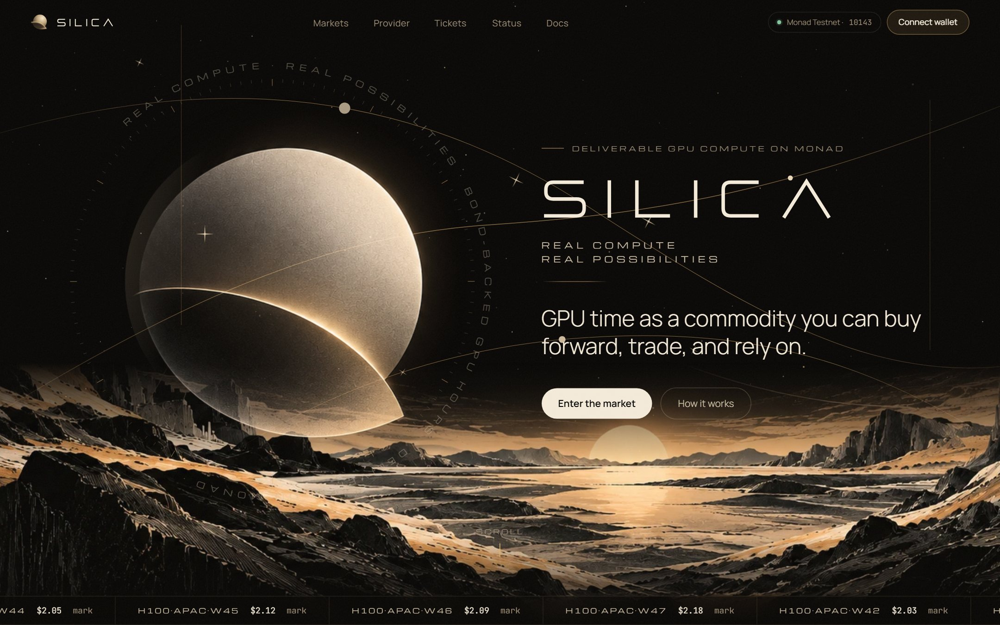
</p>

## Contents

[Why it exists](#why-it-exists) · [How it works](#how-it-works) · [The asset](#the-asset) · [Why Monad](#why-monad) · [The three integrations](#the-three-integrations) · [Proof it works](#proof-it-works) · [What is deployed](#what-is-deployed) · [Architecture](#architecture) · [Economics](#economics) · [Running it](#running-it) · [Tests](#tests) · [Repository layout](#repository-layout) · [Trust model](#trust-model) · [What is not done](#what-is-not-done) · [Design choices](#design-choices-worth-one-line-each) · [Legal and market plan](#legal-and-market-plan) · [Credits](#credits)

## Why it exists

AI teams can't lock next month's GPU price, and small GPU providers can't pre-sell idle capacity with any confidence. Exchanges have started listing compute, but every product so far settles in cash:

| Venue | What you get | Delivers a GPU? | Protects the buyer if the provider fails? |
| --- | --- | :---: | :---: |
| CME, ICE·Ornn, Kalshi, Injective | cash settlement on a price index | no | no |
| Spot GPU clouds | an hour at today's price, if capacity exists | yes | no |
| **Silica** | **a forward on one specific GPU-hour, backed by the provider's bond** | **yes** | **yes: 1.5× from the bond** |

Nobody offers the third row today. A cash-settled index hedges the price, but a training run needs the GPU. A spot cloud gives you the GPU, but nothing happens to the provider if it doesn't show up. Silica gives you both: the hour itself, and a bond that pays you if it isn't delivered.

## How it works

<picture>
  <source media="(prefers-color-scheme: dark)" srcset=".github/readme/fig-lifecycle-dark.png">
  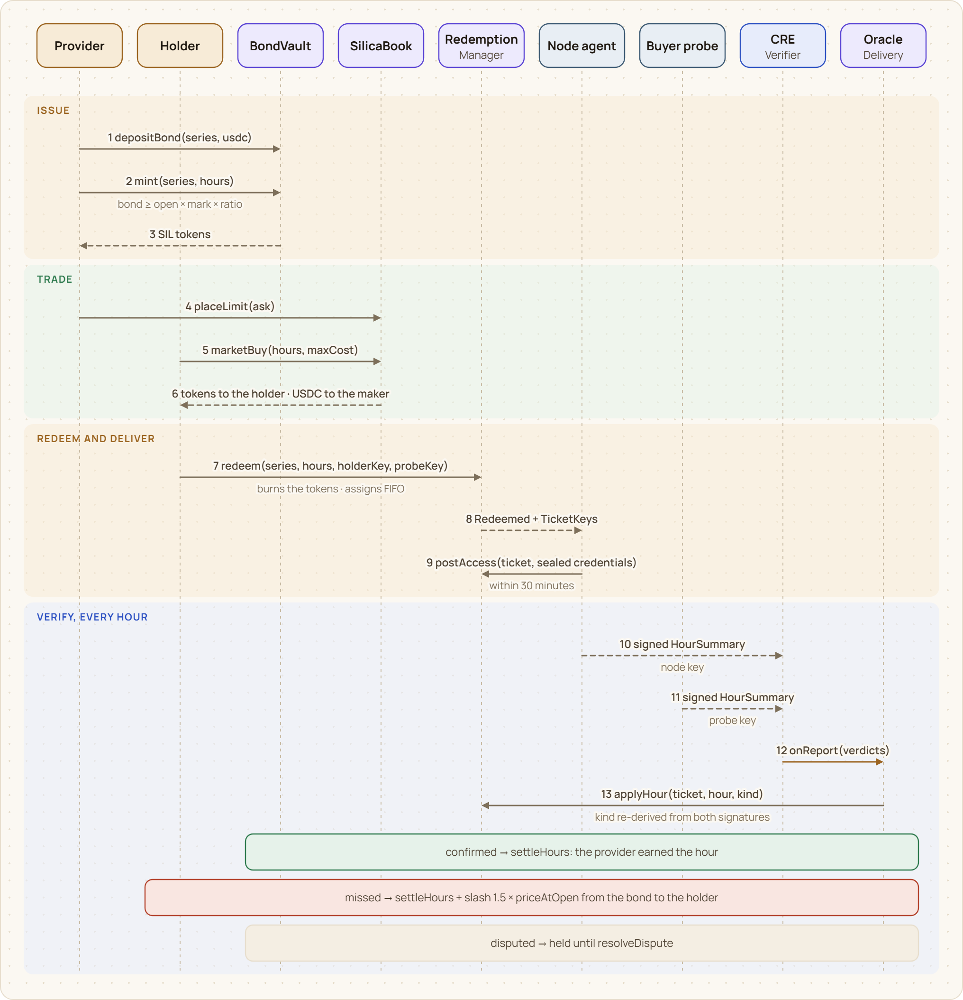
</picture>

1. **Issue.** A provider deposits USDC into `BondVault` and mints hours of one series. The vault only mints while `bond ≥ open hours × mark × bond ratio` and the provider isn't margin-called.
2. **Trade.** The tokens trade on `SilicaBook`, a price-time-priority order book with $0.01 ticks, one per series. A market maker quotes a two-sided ladder around the mark; AI teams buy forward.
3. **Redeem.** In the delivery week the holder redeems whole hours. The tokens burn, the hours are assigned across providers first-in first-out, and each provider has 30 minutes to post SSH and Jupyter credentials **sealed to a key derived from the holder's wallet signature**, or anyone can call `slashUnserved`.
4. **Verify, every hour.** The provider's node and an independent buyer probe each sign an EIP-712 summary of the hour: 12 health checks and the GPU's UUID hash. The CRE Delivery Verifier fetches both under consensus and reports them; `DeliveryOracle` recovers both signers and decides.

<picture>
  <source media="(prefers-color-scheme: dark)" srcset=".github/readme/fig-verdict-rules-dark.png">
  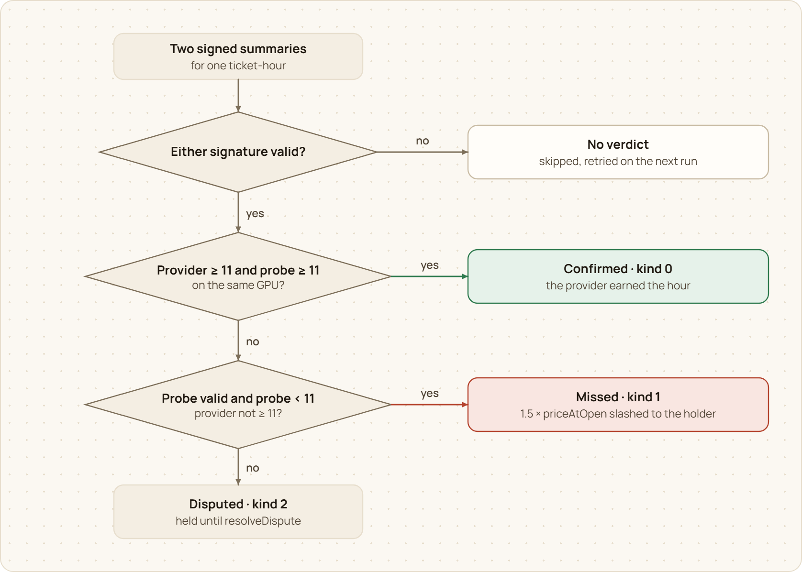
</picture>

| Provider node (signed) | Buyer probe (signed) | Verdict | Money |
| --- | --- | --- | --- |
| ≥ 11 of 12 checks | ≥ 11 of 12, same GPU | **confirmed** | the hour settles to the provider |
| < 11, or absent | < 11 | **missed** | 1.5 × `priceAtOpen` from the bond to the holder |
| any other combination | | **disputed** | held: neither paid nor slashed until `resolveDispute` |
| no valid signature on either side | | no verdict | skipped and retried on the next run |

A provider can never grade itself: a miss needs the probe's signature, a confirmation needs both, and a node that goes silent can't sign, so the probe's evidence alone slashes it.

**Worked example**, reproduced exactly in `contracts/test/Silica.t.sol`: 1,000 hours minted against a **$600** bond. A buyer redeems 100 hours at **$2.05**, and 10 of them are missed. The buyer receives **$30.75** (10 × $2.05 × 1.5), and **$569.25** of bond returns to the provider.

<picture>
  <source media="(prefers-color-scheme: dark)" srcset=".github/readme/fig-bond-split-dark.png">
  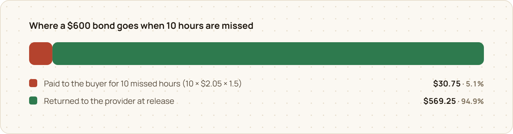
</picture>

## The asset

One token is one hour of one GPU, in one region, in one ISO week:

| Property | Value |
| --- | --- |
| Example series | `SIL·H100·APAC·W44` |
| Unit | 1 token (18 decimals) = 1 H100-80GB hour |
| Quote and bond currency | USDC (6 decimals; `MockUSDC` with a public faucet on testnet) |
| Delivery window | Monday 00:00 → Sunday 23:59:59 UTC of the series week |
| Bond ratio | 30% of notional · 20% after 1,000 confirmed hours at ≥ 99% · 40% below 95% reliability (after 10+ hours) |
| Missed hour | the holder is paid **1.5 ×** the mark at redemption, from the provider's bond |
| Order book | price-time priority, $0.01 ticks, 10 USDC minimum, self-trades rejected |
| Live series | W42 (this week, the demo series with 5-minute hours) and W44 – W47 (the forward curve) |

## Why Monad

- **Verification is high-frequency.** One provider with 64 GPUs produces 64 delivery verdicts an hour, over 10,000 a week, and each one moves money. That is only affordable at Monad's throughput and fees.
- **Every series is its own market.** GPU model × region × week multiplies into many small books, each needing cheap order placement, cancels and fills.
- **It feels like an exchange.** 400 ms blocks and 800 ms finality make the book usable by hand, with the order book re-sorting as you watch.
- **Designed for Monad's gas model.** Monad bills the full gas limit, so every write carries an explicit gas limit and CRE reports carry only what changed.

## The three integrations

### Chainlink CRE · settlement

CRE is the settlement layer. Every economic outcome after a trade is decided by one of two TypeScript workflows (`@chainlink/cre-sdk` 1.23), both delivering signed reports to `DeliveryOracle`.

<picture>
  <source media="(prefers-color-scheme: dark)" srcset=".github/readme/fig-cre-workflows-dark.png">
  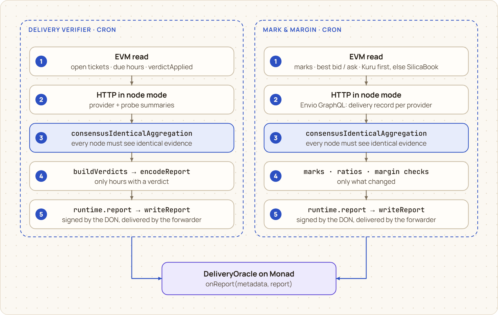
</picture>

| | Delivery Verifier | Mark & Margin |
| --- | --- | --- |
| Trigger | cron | cron |
| Chain reads | open tickets, due hours, `verdictApplied` (Multicall3-batched) | marks, best bid/ask (Kuru first, else SilicaBook), every provider position |
| HTTP under consensus | provider node + buyer probe summaries (`consensusIdenticalAggregation`) | Envio GraphQL: confirmed and missed hours per provider |
| Writes | verdicts → `applyHour` → confirm / slash / dispute | new marks, bond ratios, margin checks |
| Contract-side check | both EIP-712 signatures recovered, verdict re-derived | chain selector, strictly increasing `scheduledAt` |

Built for CRE's production limits, not just the simulator: at most **15 chain reads per run** (batched through Multicall3), **5 KB per read response**, and gas sized to each report (900k / 1.5M).

Live on Monad Testnet through Chainlink's forwarder `0xB9F7…d192`:

| Run | CLI output | Onchain result | Tx |
| --- | --- | --- | --- |
| `cre workflow simulate delivery-verifier --broadcast` | `ticket 7 hour 0: provider 0/12, probe 0/12` → `1 verdicts, success` | hour missed, **$3.05** paid to the buyer | [`0xf39c…53b8`](https://testnet.monadvision.com/tx/0xf39c4691e4c0e35b5a0ce69833f7cee6a0fa7e7e53cbbc61f3e256aa874453b8) |
| `cre workflow simulate mark-and-margin --broadcast` | Envio reliability read → `1 marks, 5 ratios, 6 margin checks, success` | NeoGPU to a 40% ratio, **margin-called on 4 series** | [`0x8dc3…19b0`](https://testnet.monadvision.com/tx/0x8dc3ab5edb43d9b5952eb7aa158c214cfd487960ed1dc2076c9e5efb2dfa19b0) |

Read: [`cre/delivery-verifier/main.ts`](cre/delivery-verifier/main.ts) · [`cre/mark-and-margin/main.ts`](cre/mark-and-margin/main.ts) · [`contracts/src/DeliveryOracle.sol`](contracts/src/DeliveryOracle.sol) · [docs: Chainlink CRE](https://silica-monard.vercel.app/docs/integrations/chainlink-cre)

### Envio · the read layer that sets collateral

Envio's data drives the collateral rules, not just the UI. Delivery becomes reputation, and reputation sets the bond:

<picture>
  <source media="(prefers-color-scheme: dark)" srcset=".github/readme/fig-feedback-dark.png">
  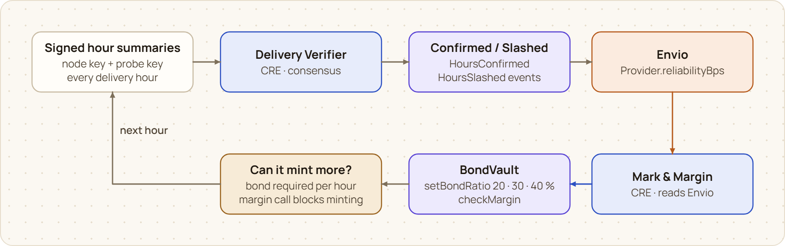
</picture>

- **Indexed:** 5 protocol contracts, 23 events, synced over **HyperSync**, hosted on **Envio Cloud**.
- **Derived, not mirrored:** 13 entities, including `Provider` with `reliabilityBps`, `Position`, `Series`, `ForwardPoint`, `Ticket` with a per-hour `HourVerdict`, `Order`, `Level`, `Trade`, a 1-hour `Candle`, `MarginCallEvent`, `CreReport` and `Stats`.
- **Feeds the protocol:** CRE Mark & Margin reads each provider's record from Envio and turns it into the bond ratio written onchain. That loop ran live: Envio showed NeoGPU at 13 confirmed and 8 missed hours (61.9%), CRE moved it to 40%, and the 4 resulting `MarginCallEvent`s came straight back into Envio.
- **Feeds the app:** price chart and trade tape, provider risk panel, ticket timelines, sealed-access ciphertext, and the CRE report log on `/status`.

```graphql
{ Provider(order_by: {reliabilityBps: asc}) { id hoursConfirmed hoursMissed reliabilityBps openMarginCalls } }
```

Read: [`indexer/schema.graphql`](indexer/schema.graphql) · [`indexer/src/EventHandlers.ts`](indexer/src/EventHandlers.ts) · [`apps/web/lib/envio.ts`](apps/web/lib/envio.ts) · [docs: Envio](https://silica-monard.vercel.app/docs/integrations/envio)

### Kuru · a new asset class: deliverable compute

Kuru Spot V2 market creation and the token whitelist are admin-only (`whitelistSpotToken` reverts `Unauthorized()` for outside callers, which we checked), so we built everything up to that call, and the switch-over is automatic:

<picture>
  <source media="(prefers-color-scheme: dark)" srcset=".github/readme/fig-kuru-listing-dark.png">
  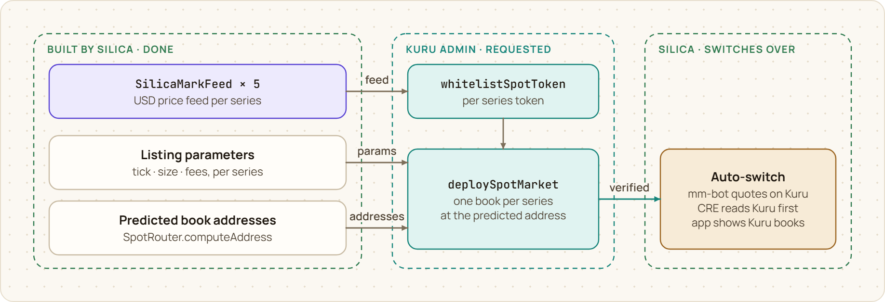
</picture>

- **Price feeds:** one `SilicaMarkFeed` per series, deployed and verified, in the read interface of Kuru's own testnet feeds (`fetchPrice()` / `priceUsd18()` in USD with 18 decimals, `observedAt()`, `maxPriceAge() = 300`). Each serves the mark Chainlink CRE writes onchain.
- **Exact listing:** parameters modelled on Kuru's xStock books (`sizePrecision 1e10`, `pricePrecision 1e4`, $0.01 tick, $0.02 passive band), and the book addresses predicted by `SpotRouter.computeAddress`. The same call reproduces Kuru's live MON/USDC book address.
- **Switches on by itself:** the market maker, CRE Mark & Margin and the app all watch `SpotRouter.verifiedSpotMarket(book)`. Once Kuru verifies a book, the market maker deposits into AccountCore and quotes a post-only ladder through Kuru's SDK, CRE takes the mid from it, and the app shows it.
- **Listing requested** on 13 Oct 2026. Full spec: [`docs/kuru-listing.md`](docs/kuru-listing.md).

## Proof it works

Everything below is a real Monad Testnet transaction, reproducible from the scripts in this repository.

<picture>
  <source media="(prefers-color-scheme: dark)" srcset=".github/readme/fig-ticket-7-dark.png">
  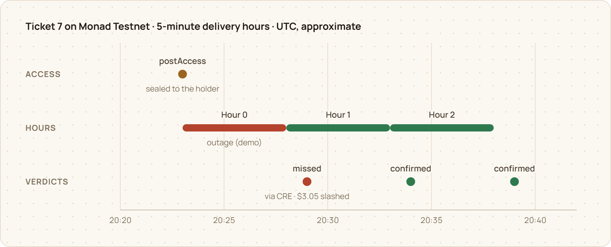
</picture>

**Outage → slash** (ticket #2, from `pnpm demo:slash`). The buyer was paid **$6.06** = 2 hours × $2.02 × 1.5:

| Step | Tx |
| --- | --- |
| buy W42 hours | [`0x212c…56d3`](https://testnet.monadvision.com/tx/0x212cecb6f65d15fc14bc5d5ab57bad80126f65b1191da75273af42a11a7956d3) |
| redeem | [`0x0d45…4bdb`](https://testnet.monadvision.com/tx/0x0d453a4b9ca542d4b85a2fe214ce23ba5f7cc23bbe13c27092cf8bc3e8df4bdb) |
| sealed access posted | [`0x1796…df57`](https://testnet.monadvision.com/tx/0x17969401bb2f7a741b9badca6e2df7b740962d8e0d97abd18532904b4d73df57) |
| hour 0 confirmed | [`0x2a05…6412`](https://testnet.monadvision.com/tx/0x2a054d06edd32d158b03992f3b78d4ed5e5b49b914a4931ef3e8fed8aaf86412) |
| hour 1 slashed | [`0x0188…29ca`](https://testnet.monadvision.com/tx/0x01889e326fef3d4eddd8f0a90080bcce38d38f47415961259d07464ae85229ca) |
| hour 2 slashed | [`0x8b92…7e0a`](https://testnet.monadvision.com/tx/0x8b9265b49afcfd969fc1eb437869810ee36e247c72cbd7a4290dbbce72667e0a) |
| hour 3 confirmed | [`0x733b…3102`](https://testnet.monadvision.com/tx/0x733bc986360ed7fc9e45c807446ec9520dc5db07d6431e45723f2313238b3102) |

**Happy path through CRE itself** (ticket #4, both hours confirmed through Chainlink's forwarder): [`0x9890…9089`](https://testnet.monadvision.com/tx/0x98907a4d485a6b0dfbb2d074388959783a152fbb92d12d33fb0166abd2209089), [`0xf9c1…d168`](https://testnet.monadvision.com/tx/0xf9c10beb5c460b3c9b35e45a9073f94bc24115c2225bb72cb61e4f1fb503d168).

**Protocol totals** (from Envio at the time of writing):

<picture>
  <source media="(prefers-color-scheme: dark)" srcset=".github/readme/fig-proof-outcomes-dark.png">
  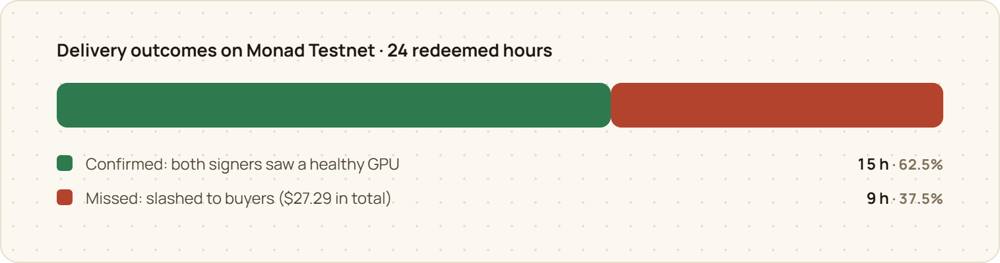
</picture>

| Tickets | Hours redeemed | Confirmed | Missed | Slashed to buyers | Trades | Volume | Oracle reports |
| :---: | :---: | :---: | :---: | :---: | :---: | :---: | :---: |
| 7 | 24 | 15 | 9 | **$27.29** | 15 | $228.94 | 24 |

The misses are deliberate: the demo scripts take a provider node down to show the slash path. Recorded walkthroughs of the demo, the CRE simulation and the Envio data flow are linked in the submission.

## What is deployed

<!-- ADDRESSES:START -->
| Contract | Address |
| --- | --- |
| SeriesRegistry | [`0x7889B29861aF261026a1aaa9983954DE0E76D8a6`](https://testnet.monadvision.com/address/0x7889B29861aF261026a1aaa9983954DE0E76D8a6) |
| BondVault | [`0xa730F61B3A0c0f3042EEd7b458EcF3aD392bFa00`](https://testnet.monadvision.com/address/0xa730F61B3A0c0f3042EEd7b458EcF3aD392bFa00) |
| RedemptionManager | [`0xf21bd145cd5C7d306033bfdF5FE9Cf87c3738dab`](https://testnet.monadvision.com/address/0xf21bd145cd5C7d306033bfdF5FE9Cf87c3738dab) |
| DeliveryOracle | [`0xF5d5419A6f1DaA315fa6b1312e24A639D33d2a52`](https://testnet.monadvision.com/address/0xF5d5419A6f1DaA315fa6b1312e24A639D33d2a52) |
| SilicaBook | [`0x783d37B75E294A92cF54c017dF9FA7e8A05c9Be3`](https://testnet.monadvision.com/address/0x783d37B75E294A92cF54c017dF9FA7e8A05c9Be3) |
| MockUSDC | [`0x077eF50fd19bc7A77f3Bd7Fd8A3Ad028E7014561`](https://testnet.monadvision.com/address/0x077eF50fd19bc7A77f3Bd7Fd8A3Ad028E7014561) |
| SIL·H100·APAC·W42 (demo week) token | [`0x0a34471DC8c2893a8c63e4Af603535e3F496d6ed`](https://testnet.monadvision.com/address/0x0a34471DC8c2893a8c63e4Af603535e3F496d6ed) |
| SIL·H100·APAC·W44 token | [`0x841661c94Af0384680755bB65738027EA1FCF093`](https://testnet.monadvision.com/address/0x841661c94Af0384680755bB65738027EA1FCF093) |
| SIL·H100·APAC·W45 token | [`0x7a2E94F1fA56D36E5144EC849311de164341C8B3`](https://testnet.monadvision.com/address/0x7a2E94F1fA56D36E5144EC849311de164341C8B3) |
| SIL·H100·APAC·W46 token | [`0x5d76f956712B9E9A357Be1F1E25b79A299B8814F`](https://testnet.monadvision.com/address/0x5d76f956712B9E9A357Be1F1E25b79A299B8814F) |
| SIL·H100·APAC·W47 token | [`0x5561b62F6B73097948c32f94c7ab0F97311AE30a`](https://testnet.monadvision.com/address/0x5561b62F6B73097948c32f94c7ab0F97311AE30a) |
| CRE forwarder (MockKeystoneForwarder) | [`0xB9F79d863261869B234c481D1f9A7af84AeAd192`](https://testnet.monadvision.com/address/0xB9F79d863261869B234c481D1f9A7af84AeAd192) |

Deployed at block 70687435. All sources are verified on MonadVision (Sourcify, exact match). Demo delivery hour: 300 s.
<!-- ADDRESSES:END -->

Kuru price feeds (one per series, verified) and the Kuru books predicted for our listing are in [`packages/shared/kuru.10143.json`](packages/shared/kuru.10143.json) and on `/status`.

| Hosted piece | Where |
| --- | --- |
| Web app and documentation | [silica-monard.vercel.app](https://silica-monard.vercel.app) and [/docs](https://silica-monard.vercel.app/docs) (Vercel) |
| Indexer | Envio Cloud, [GraphQL endpoint](https://indexer.dev.hyperindex.xyz/581ef33/v1/graphql) |
| Provider agent + market maker | [silica-agent.onrender.com](https://silica-agent.onrender.com/health) (Render) |
| Buyer probe + CRE relay | [silica-probe.onrender.com](https://silica-probe.onrender.com/health) (Render) |

<table>
  <tr>
    <td width="50%">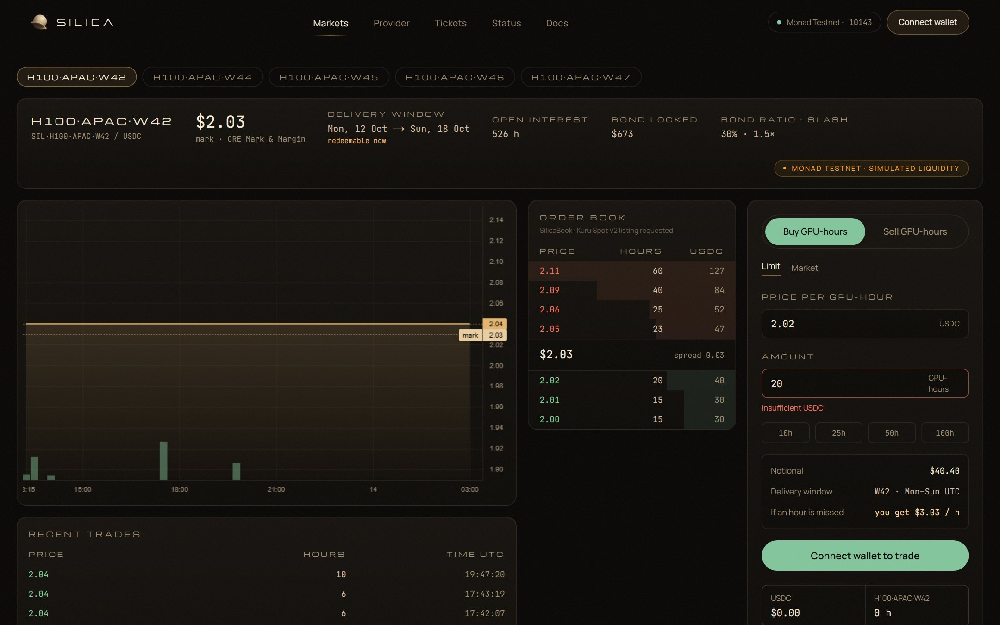</td>
    <td width="50%">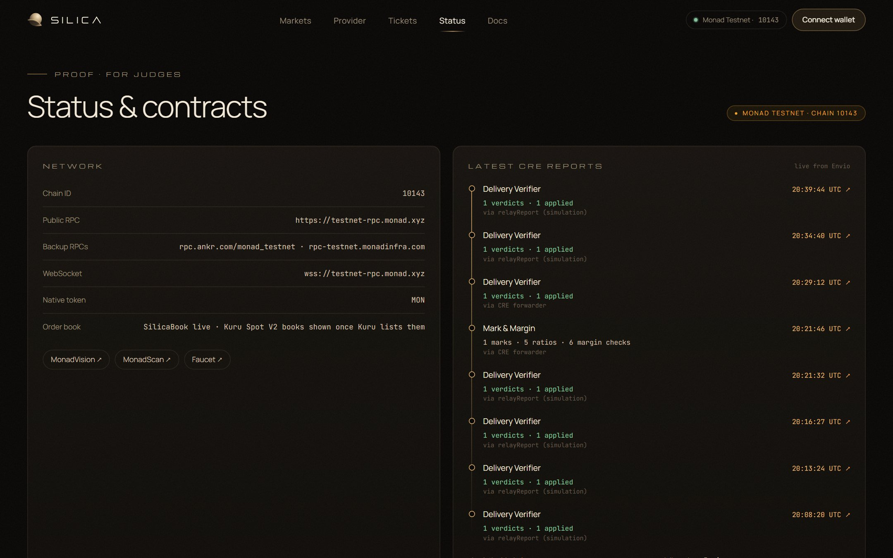</td>
  </tr>
  <tr>
    <td align="center"><sub>Trade: the live book, chart and order form</sub></td>
    <td align="center"><sub>Status: contracts, CRE reports and disclosures</sub></td>
  </tr>
</table>

## Architecture

<picture>
  <source media="(prefers-color-scheme: dark)" srcset=".github/readme/fig-system-dark.png">
  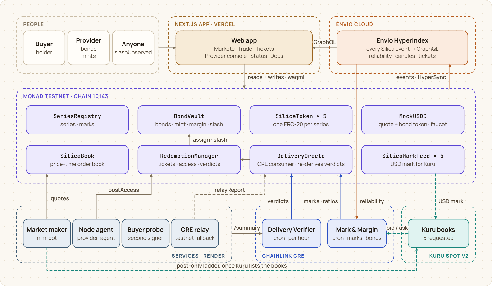
</picture>

Settlement authority lives in exactly one place, `DeliveryOracle`. It accepts reports from the CRE forwarder (and, on testnet only, from a labelled relayer while `simulationMode` is on), and it **re-derives every delivery verdict from the two EIP-712 signatures itself**. A report that every CRE node agreed on still cannot confirm or slash an hour that the signatures don't support.

| Component | Role | Where |
| --- | --- | --- |
| `SeriesRegistry` | creates series and their tokens; holds each series' mark | Monad |
| `BondVault` | bonds, the mint rule, bond ratios, margin calls, slashes, release | Monad |
| `SilicaToken` × 5 | one ERC-20 per series; minted by the vault, burned on redeem | Monad |
| `SilicaBook` | price-time-priority order book, escrowed bids and asks, one book per series | Monad |
| `RedemptionManager` | tickets, FIFO assignment, sealed access, per-hour verdicts, `slashUnserved` | Monad |
| `DeliveryOracle` | the CRE consumer: authenticates reports, re-derives verdicts, routes marks and ratios | Monad |
| `SilicaMarkFeed` × 5 | the CRE mark in Kuru's USD price-feed interface | Monad |
| Delivery Verifier, Mark & Margin | the two CRE workflows | Chainlink CRE |
| HyperIndex indexer | 13 entities from 23 events; reliability, candles, tickets, reports | Envio Cloud |
| `provider-agent`, `buyer-probe`, `mm-bot`, `cre-relay` | access and signed summaries, the independent witness, quotes, the run loop | Render |
| Web app + docs | markets, trading, the provider console, tickets, status, documentation | Vercel |

Every privileged function and the role that guards it:

<picture>
  <source media="(prefers-color-scheme: dark)" srcset=".github/readme/fig-roles-dark.png">
  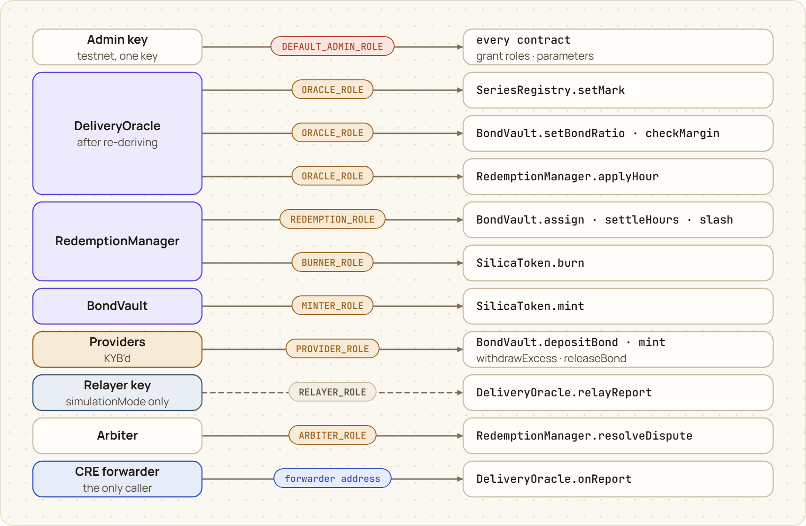
</picture>

And where each piece is hosted, and what it needs from the others:

<picture>
  <source media="(prefers-color-scheme: dark)" srcset=".github/readme/fig-hosting-dark.png">
  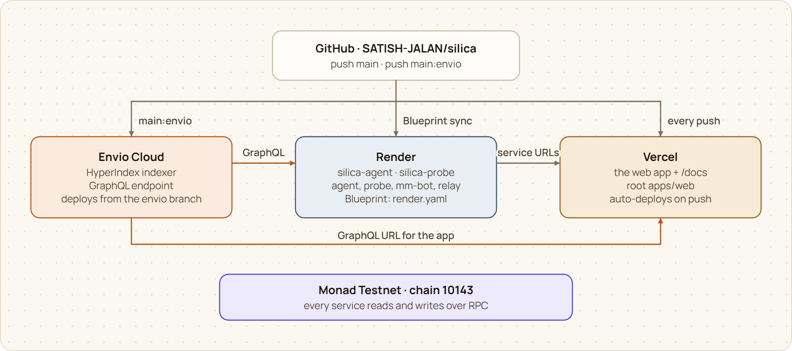
</picture>

The full architecture, with 42 diagrams across 46 pages, is in the [documentation](https://silica-monard.vercel.app/docs).

## Economics

A provider's collateral follows its delivery record. Everyone starts at 30%; 1,000 confirmed hours at 99% or better earns 20%; falling below 95% after 10 hours costs 40%.

<picture>
  <source media="(prefers-color-scheme: dark)" srcset=".github/readme/fig-bond-ratios-dark.png">
  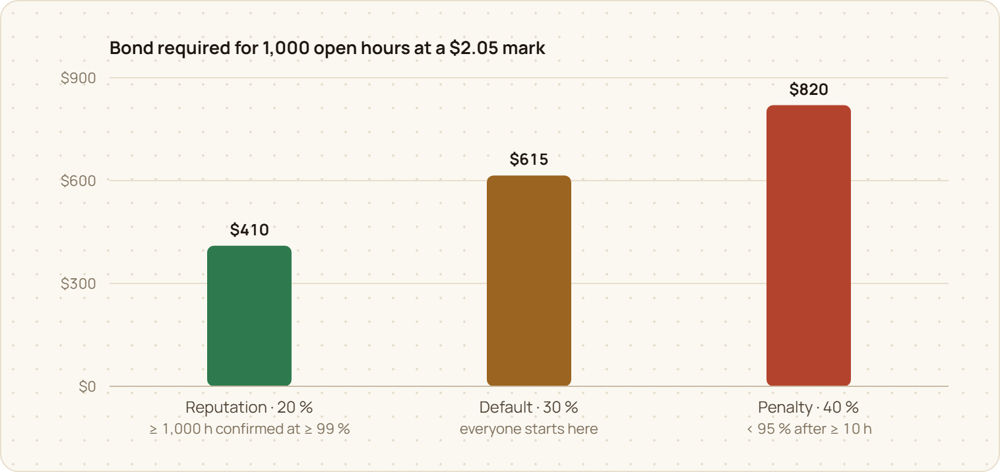
</picture>

Mark & Margin writes those ratios, the marks and the margin checks; the margin events flow back into Envio:

<picture>
  <source media="(prefers-color-scheme: dark)" srcset=".github/readme/fig-mark-margin-dark.png">
  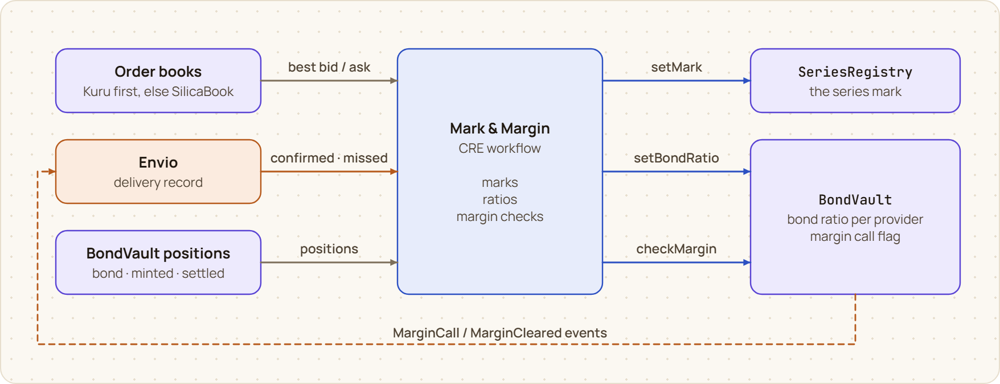
</picture>

The marks of successive weekly series make a forward curve for compute:

<picture>
  <source media="(prefers-color-scheme: dark)" srcset=".github/readme/fig-forward-curve-dark.png">
  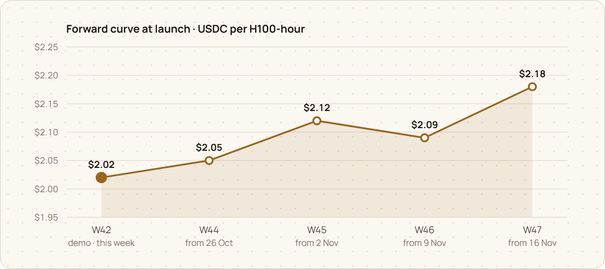
</picture>

## Running it

Prerequisites: Node 22+, pnpm 10, Foundry ≥ 1.8, Bun (CRE workflows), the CRE CLI, and Docker + WSL on Windows if you run Envio locally.

```bash
pnpm install
cp .env.example .env              # fresh testnet-only keys: cast wallet new
cd contracts && forge test        # 31 tests: unit, fuzz, invariants, the worked example, Kuru feeds
```

<details>
<summary><b>Local, end to end on anvil</b></summary>

```bash
anvil --chain-id 10143                                   # terminal 1
cast rpc anvil_setCode 0xcA11bde05977b3631167028862bE2a173976CA11 \
  $(cast code 0xcA11bde05977b3631167028862bE2a173976CA11 --rpc-url https://testnet-rpc.monad.xyz)   # Multicall3

cd contracts && set -a && . ../.env && set +a
export RPC_URL=http://127.0.0.1:8545 DEMO_HOUR_SECONDS=60
forge script script/Deploy.s.sol --rpc-url $RPC_URL --broadcast
forge script script/Seed.s.sol   --rpc-url $RPC_URL --broadcast

cd ../services                                           # one terminal each
pnpm agent ; pnpm probe ; pnpm mm ; RELAY_MODE=local pnpm relay
pnpm demo:slash                                          # buy → redeem → outage → slash

cd ../apps/web && pnpm dev                               # see apps/web/.env.example
```
</details>

<details>
<summary><b>Monad Testnet</b></summary>

```bash
cd contracts && set -a && . ../.env && set +a
forge script script/Deploy.s.sol         --rpc-url https://testnet-rpc.monad.xyz --broadcast   # writes packages/shared/addresses.10143.json
forge script script/Seed.s.sol           --rpc-url https://testnet-rpc.monad.xyz --broadcast
forge script script/DeployKuruFeeds.s.sol --rpc-url https://testnet-rpc.monad.xyz --broadcast  # Kuru price feeds
node packages/shared/scripts/gen-kuru.mjs                 # Kuru listing params + predicted books
node cre/gen-config.mjs && node indexer/gen-config.mjs
cre login
cd cre && cre workflow simulate delivery-verifier --target staging-settings --broadcast
cd ../services && RELAY_MODE=cre pnpm relay               # both workflows on a schedule
```
</details>

<details>
<summary><b>Hosting</b></summary>

Envio Cloud (indexer) → Render (`render.yaml`: agent + market maker, probe + relay, one image from `Dockerfile.services`) → Vercel (`apps/web`, which also builds and serves the docs). Step by step in [`docs/DEPLOY.md`](docs/DEPLOY.md).
</details>

<details>
<summary><b>Documentation site</b></summary>

```bash
pnpm --filter web docs:dev           # http://localhost:5173/docs/
pnpm --filter web docs:build         # built into apps/web/public/docs, served at /docs
```

The web app's `build` script builds the docs first, so every Vercel deploy ships both.
</details>

## Tests

| Command | What it checks |
| --- | --- |
| `cd contracts && forge test` | 31 tests in 4 suites: the mint rule and every revert, FIFO redemption across providers, the 30-minute access deadline, every verdict path (a dead node still slashed, disagreement disputed and never paid, a forged provider signature disputed), early and repeated verdicts refused, the forwarder, chain and freshness checks, relaying disabled outside simulation, bond release, the faucet cooldown, the worked example, the order book and the Kuru feed |
| (fuzz, in the same run) | `testFuzz_MintNeverExceedsBond`, `testFuzz_SlashCappedAtBond` |
| (invariants, in the same run) | the vault stays solvent; token supply = minted − redeemed; every ticket's hours add up |
| `pnpm --filter web typecheck` · `pnpm --filter @silica/services typecheck` · `pnpm --filter @silica/shared typecheck` | the app, the services and the shared package against the generated ABIs |
| `cd services && pnpm demo:happy` · `pnpm demo:slash` | end to end against a live chain: buy, redeem, access, verdicts, and (for `slash`) an outage paid out to the buyer |

## Repository layout

```
contracts/                 Foundry · network = "monad" · solc 0.8.26 · via_ir
  src/                       SeriesRegistry · BondVault · RedemptionManager · DeliveryOracle
                             SilicaBook · SilicaToken · MockUSDC · kuru/SilicaMarkFeed
  src/chainlink/             ReceiverTemplate + IReceiver (CRE consumer)
  test/                      unit, fuzz, invariants, worked example, Kuru feed
  script/                    Deploy · Seed · DeployKuruFeeds
packages/shared/           ABIs, deployed addresses, units, EIP-712, report codec,
                           verifier rules, sealed-box crypto, Kuru adapter
services/                  provider-agent · buyer-probe · mm-bot (+ Kuru venue) · cre-relay
                           demo + test-buyer scripts · run.sh (multi-process entrypoint)
cre/                       delivery-verifier · mark-and-margin (CRE TypeScript SDK)
indexer/                   Envio HyperIndex v3: config generator, schema, handlers
apps/web/                  Next.js 16 · wagmi + RainbowKit · Envio GraphQL · GSAP
  docs/                      VitePress documentation, served by the app at /docs
    .vitepress/figures/      the SVG figure kit and all 42 figures (docs + README images)
docs/                      DEPLOY · SUBMISSION · kuru-listing
.github/readme/            the README's figures and screenshots
render.yaml                Render Blueprint · Dockerfile.services
```

## Trust model

| Party | Trusted for | Not trusted for |
| --- | --- | --- |
| Provider node | its own signature over each hour | its verdict: it can't confirm alone, and silence counts against it |
| Buyer probe | its own signature over each hour | paying itself: it can only make a miss possible, never confirm alone |
| Chainlink CRE | delivering the evidence that every node saw identically | the verdict: `DeliveryOracle` re-derives it from both signatures |
| CRE forwarder | being the only caller of `onReport` | the content of delivery verdicts (re-derived); marks and ratios are trusted to it |
| Envio | the delivery record Mark & Margin reads, under consensus | anything onchain: every Envio number is derived from onchain events anyone can re-index |
| Admin key (testnet) | roles and parameters | disclosed as a single key; the mainnet plan is a multisig plus timelock |
| Relayer (testnet) | delivering report bytes while `simulationMode` is on | anything once simulation is off: `relayReport` reverts |

The weakest link today is the simulation forwarder: it supplies no workflow metadata, so marks and ratios are only as trusted as it is. Delivery verdicts are not affected. The full model is in the [docs](https://silica-monard.vercel.app/docs/architecture/trust-model).

## What is not done

The honest list. None of it is hidden elsewhere in the repo.

- **Provider nodes are simulated.** `provider-agent` runs with `FAKE_GPU=1` and simulates `nvidia-smi` and the delivered host. The two providers, NeoGPU and Basalt Cloud, are seeded test wallets, not companies.
- **Liquidity is testnet-simulated.** The market maker only quotes, and fills come from separate, labelled test-buyer wallets. It is never presented as organic volume.
- **CRE runs in simulation, not on a DON.** Both workflows run through `cre workflow simulate --broadcast`. The hosted relay delivers the same report bytes through a testnet-only `relayReport()` (`RELAYER_ROLE`, only while `simulationMode` is on), and `/status` labels every report with its path. Moving to production is one `setForwarderAddress` call plus pinning the workflow ID.
- **Mock forwarder trust.** The simulation forwarder supplies no workflow metadata, so marks and ratios are only as trusted as that forwarder. Delivery verdicts are not affected, because the contract re-derives them from signatures.
- **No Kuru books yet.** Kuru market creation is permissioned. Everything up to `deploySpotMarket` is built and requested, and SilicaBook is the live venue until then.
- **One probe.** The buyer probe is a single service we run. The mainnet plan is a probe network run by independent operators.
- **Disputes are resolved by a role, not a process.** Disputed hours wait for `resolveDispute` (`ARBITER_ROLE`), and there is no dispute UI.
- **Demo timing.** W44–W47 deliver from 26 Oct, so a W42 demo series (the current week) is live for redemption, and one delivery hour lasts 5 minutes.
- **Single admin key, no audit.** Disclosed. The mainnet plan is a multisig, a timelock on parameter changes, and an external audit.
- **Free-tier hosting.** The Render services keep themselves awake, but a cold start can still add about 30 seconds to the first request.

## Design choices worth one line each

- **The oracle re-derives verdicts instead of trusting the report.** Consensus on the evidence is CRE's job; turning evidence into money is the contract's, so a bad report cannot pay or slash anyone.
- **The provider can never grade itself.** A miss needs the buyer's probe to sign it, and a confirmation needs both sides.
- **Access is sealed to a key derived from the holder's wallet signature.** Nothing secret is stored anywhere, and only the holder can open it.
- **Reports carry only what changed.** Monad bills the full gas limit, so empty margin checks and unchanged marks are never written.
- **Collateral follows reputation.** Envio turns verdicts into a delivery record and CRE turns the record into a bond ratio, so good providers post less and bad ones are margin-called.
- **Addresses are never pasted by hand.** The deploy script writes `addresses.10143.json`, and every config (CRE, Envio, Kuru, app) is generated from it.
- **One drawing, two outputs.** Every diagram is a small SVG function; the docs render it inline and the README uses PNGs exported from the same source, in light and dark.

## Legal and market plan

A Silica token is a **prepaid, physically delivered service contract**: the right to one GPU-hour. It is not a share, a profit claim or a cash-settled derivative. Only KYB'd providers that sign standard service terms may issue, and we stay on testnet until counsel reviews the structure. Liquidity starts narrow (one GPU, one region, four weekly series), seeded by provider asks and a market maker, then Kuru books and a partner market maker. Full answers and the roadmap are in [`docs/SUBMISSION.md`](docs/SUBMISSION.md) and the [docs](https://silica-monard.vercel.app/docs/reference/roadmap).

## Credits

- **OpenZeppelin Contracts v5:** ERC-20, AccessControl, ReentrancyGuard, SafeERC20, EIP-712, ECDSA.
- **Chainlink CRE:** `ReceiverTemplate` and `IReceiver` adapted from the CRE consumer-contract docs; `@chainlink/cre-sdk`. Chain selector from `smartcontractkit/chain-selectors`.
- **Envio HyperIndex v3.**
- **Kuru Spot V2 SDK** (`@toxicflow-labs/ts-sdk`), used by the market maker's Kuru venue; the OrderBook and SpotRouter read ABIs follow the SDK's.
- **Other libraries:** wagmi, viem, RainbowKit, TanStack Query, TradingView lightweight-charts, GSAP (`@gsap/react`), tweetnacl, @noble/hashes, hono, zod, VitePress.
- **Monad:** network details from the Monad developer docs.

### AI tool disclosure

This project was built with AI assistance (Anthropic's Claude, via Claude Code) for code generation, testing, documentation and design implementation, under the direction of the team, who made the product, architecture and design decisions. The narration in the demo, CRE and Envio videos is AI-generated (Microsoft neural voice). All code is in this repository and was reviewed and tested as described above.

### License

MIT, see [LICENSE](LICENSE).
