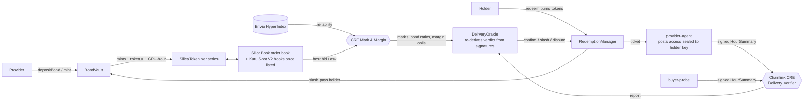

# Silica

**Deliverable, bond-backed GPU-hour forwards on Monad.** Real compute. Real possibilities.

A GPU provider sells standardized contracts such as *one H100-80GB hour, APAC region, delivered in ISO week 44*, and must lock a USDC bond to mint them. The tokens trade on an onchain order book. Holders redeem them for real GPU time, every delivered hour is checked by two independent sources under Chainlink CRE consensus, and a missed hour slashes the provider's bond straight to the holder at 1.5× the redemption price.

Every exchange listing compute today (CME, ICE·Ornn, Kalshi, Injective) is cash-settled on a price index. Silica delivers the compute itself.

> **Testnet only. Simulated parts are labelled everywhere.** Provider GPU nodes run in `FAKE_GPU=1` mode, book liquidity comes from a market-maker bot that only quotes plus separate labelled test-buyer wallets, and CRE workflows run via `cre workflow simulate` (see [Honest disclosures](#honest-disclosures)). No real money, no mainnet tokens, no offering.

Monad Metropolis · Track 1 (Onchain Finance & Trading) · bounties: Kuru, Chainlink CRE, Envio.

**Live:** [silica-monard.vercel.app](https://silica-monard.vercel.app) · proof page [`/status`](https://silica-monard.vercel.app/status) · Envio GraphQL [endpoint](https://indexer.dev.hyperindex.xyz/581ef33/v1/graphql)

---

## How it works



1. **Bond and mint.** `BondVault.mint` enforces `bond ≥ (minted − settled + new) × mark × bondRatio` (30%; 20% after 1,000 confirmed hours at ≥ 99%; 40% if reliability falls below 95% over 10+ hours).
2. **Trade.** `SilicaBook` is a price-time-priority limit-order book with $0.01 ticks and a 10 USDC minimum. It rejects self-trades. Kuru Spot V2 market creation is permissioned, so each series also has a deployed USD price feed in Kuru's feed interface and a book address predicted by Kuru's `SpotRouter.computeAddress` ([`docs/kuru-listing.md`](docs/kuru-listing.md)). The moment Kuru verifies a book, the market maker quotes on it, CRE takes the mark from it and the app shows it.
3. **Redeem.** In the delivery week the holder burns whole hours. The hours are split FIFO across providers, one ticket each, with `priceAtOpen` fixed at the mark.
4. **Deliver.** The provider agent seals SSH/Jupyter credentials to the holder's X25519 key (derived from a wallet signature, never stored) and posts them as an event within 30 minutes. If it doesn't, anyone can call `slashUnserved`.
5. **Verify.** Every hour, the provider node and an independent buyer probe each sign an EIP-712 `HourSummary` (12 checks). CRE fetches both under consensus and writes one report. `DeliveryOracle` **recovers both signatures onchain and re-derives the verdict itself**:
   - both sides ≥ 11/12 on the same GPU → **confirmed**;
   - the probe saw the outage and the provider can't show otherwise → **missed**, and the bond is slashed to the holder;
   - anything else → **disputed**, neither paid nor slashed.
6. **Mark and margin.** Hourly, CRE posts the book mid as the new mark and reads each provider's delivery record from Envio to set its bond ratio. Under-bonded providers get a `MarginCall` and cannot mint until they top up.

**Worked example (from the product doc, reproduced in `contracts/test/Silica.t.sol`):** 1,000 hours minted against a $600 bond; a buyer redeems 100 at $2.05; 10 hours are missed; the buyer receives **$30.75**; **$569.25** of bond returns to the provider.

## Repository

| Path | What |
| --- | --- |
| `contracts/` | Foundry (`network = "monad"`): `SeriesRegistry`, `SilicaToken`, `BondVault`, `RedemptionManager`, `DeliveryOracle` (Chainlink `ReceiverTemplate`), `SilicaBook`, `MockUSDC`, `kuru/SilicaMarkFeed` (Kuru price feed); unit, fuzz and invariant tests; deploy, seed and Kuru-feed scripts |
| `packages/shared/` | ABIs, deployed addresses (written by the deploy script), units, EIP-712 types, report encoding, verifier logic, sealed-box crypto, order-book adapter |
| `services/` | `provider-agent`, `buyer-probe`, `mm-bot`, `cre-relay`, demo scripts, test buyers (Node + TypeScript, viem, hono, zod) |
| `cre/` | Chainlink CRE TypeScript workflows `delivery-verifier` and `mark-and-margin` |
| `indexer/` | Envio HyperIndex v3: config generator, `schema.graphql`, handlers |
| `apps/web/` | Next.js 16 app: wagmi + RainbowKit, Envio GraphQL, GSAP motion |

## Run it yourself

Prerequisites: Node 22+, pnpm 10, Foundry ≥ 1.8, Bun (CRE workflows), Docker + WSL on Windows (Envio), and the CRE CLI ≥ 1.30.

```bash
pnpm install
cp .env.example .env            # fill with fresh testnet-only keys (cast wallet new)

# contracts
cd contracts && forge test      # 31 tests: unit, fuzz, invariants, the worked example, Kuru feeds
```

### Local, end to end (anvil)

```bash
anvil --chain-id 10143                                  # terminal 1
cd contracts && set -a && . ../.env && set +a
export RPC_URL=http://127.0.0.1:8545 DEMO_HOUR_SECONDS=60
forge script script/Deploy.s.sol --rpc-url $RPC_URL --broadcast
forge script script/Seed.s.sol   --rpc-url $RPC_URL --broadcast

cd ../services                                          # one terminal each
RPC_URL=http://127.0.0.1:8545 pnpm agent
RPC_URL=http://127.0.0.1:8545 pnpm probe
RPC_URL=http://127.0.0.1:8545 pnpm mm
RPC_URL=http://127.0.0.1:8545 RELAY_MODE=local pnpm relay
RPC_URL=http://127.0.0.1:8545 pnpm demo:slash           # buy → redeem → outage → slash

cd ../apps/web && pnpm dev                              # see apps/web/.env.example
```

On anvil, copy Multicall3 to its canonical address first:

```bash
cast rpc anvil_setCode 0xcA11bde05977b3631167028862bE2a173976CA11 \
  $(cast code 0xcA11bde05977b3631167028862bE2a173976CA11 --rpc-url https://testnet-rpc.monad.xyz)
```

### Monad Testnet

```bash
cd contracts && set -a && . ../.env && set +a
forge script script/Deploy.s.sol --rpc-url https://testnet-rpc.monad.xyz --broadcast   # writes packages/shared/addresses.10143.json
forge script script/Seed.s.sol   --rpc-url https://testnet-rpc.monad.xyz --broadcast
forge script script/DeployKuruFeeds.s.sol --rpc-url https://testnet-rpc.monad.xyz --broadcast   # Kuru price feeds
node packages/shared/scripts/gen-kuru.mjs            # Kuru listing: params + predicted books
node cre/gen-config.mjs && node indexer/gen-config.mjs
cre login                                            # once
cd cre && cre workflow simulate delivery-verifier --target staging-settings --broadcast
cd ../services && RELAY_MODE=cre pnpm relay          # runs both simulations on a schedule
```

## Deployed on Monad Testnet (chain 10143)

Live addresses are written by `Deploy.s.sol` to [`packages/shared/addresses.10143.json`](packages/shared/addresses.10143.json) and shown with explorer links on the app's `/status` page. Sample transaction hashes from `pnpm demo:happy` and `pnpm demo:slash` are in [`packages/shared/demo-txs.json`](packages/shared/demo-txs.json).

<!-- ADDRESSES:START -->
| Contract | Address |
| --- | --- |
| SeriesRegistry | [`0x7889B29861aF261026a1aaa9983954DE0E76D8a6`](https://testnet.monadvision.com/address/0x7889B29861aF261026a1aaa9983954DE0E76D8a6) |
| BondVault | [`0xa730F61B3A0c0f3042EEd7b458EcF3aD392bFa00`](https://testnet.monadvision.com/address/0xa730F61B3A0c0f3042EEd7b458EcF3aD392bFa00) |
| RedemptionManager | [`0xf21bd145cd5C7d306033bfdF5FE9Cf87c3738dab`](https://testnet.monadvision.com/address/0xf21bd145cd5C7d306033bfdF5FE9Cf87c3738dab) |
| DeliveryOracle | [`0xF5d5419A6f1DaA315fa6b1312e24A639D33d2a52`](https://testnet.monadvision.com/address/0xF5d5419A6f1DaA315fa6b1312e24A639D33d2a52) |
| SilicaBook | [`0x783d37B75E294A92cF54c017dF9FA7e8A05c9Be3`](https://testnet.monadvision.com/address/0x783d37B75E294A92cF54c017dF9FA7e8A05c9Be3) |
| MockUSDC | [`0x077eF50fd19bc7A77f3Bd7Fd8A3Ad028E7014561`](https://testnet.monadvision.com/address/0x077eF50fd19bc7A77f3Bd7Fd8A3Ad028E7014561) |
| SIL·H100·APAC·W42 (demo week) token | [`0x0a34471DC8c2893a8c63e4Af603535e3F496d6ed`](https://testnet.monadvision.com/address/0x0a34471DC8c2893a8c63e4Af603535e3F496d6ed) |
| SIL·H100·APAC·W44 token | [`0x841661c94Af0384680755bB65738027EA1FCF093`](https://testnet.monadvision.com/address/0x841661c94Af0384680755bB65738027EA1FCF093) |
| SIL·H100·APAC·W45 token | [`0x7a2E94F1fA56D36E5144EC849311de164341C8B3`](https://testnet.monadvision.com/address/0x7a2E94F1fA56D36E5144EC849311de164341C8B3) |
| SIL·H100·APAC·W46 token | [`0x5d76f956712B9E9A357Be1F1E25b79A299B8814F`](https://testnet.monadvision.com/address/0x5d76f956712B9E9A357Be1F1E25b79A299B8814F) |
| SIL·H100·APAC·W47 token | [`0x5561b62F6B73097948c32f94c7ab0F97311AE30a`](https://testnet.monadvision.com/address/0x5561b62F6B73097948c32f94c7ab0F97311AE30a) |
| CRE forwarder (MockKeystoneForwarder) | [`0xB9F79d863261869B234c481D1f9A7af84AeAd192`](https://testnet.monadvision.com/address/0xB9F79d863261869B234c481D1f9A7af84AeAd192) |

Deployed at block 70687435. All sources are verified on MonadVision (Sourcify, exact match). Demo delivery hour: 300 s.
<!-- ADDRESSES:END -->

## Honest disclosures

- **Testnet only.** No real money, no mainnet tokens, no offering of any financial product.
- **Provider nodes are simulated.** `provider-agent` runs with `FAKE_GPU=1`, simulating `nvidia-smi` and the delivered host. The two providers ("NeoGPU", "Basalt Cloud") are seeded test wallets, not real companies.
- **Liquidity is testnet-simulated.** `mm-bot` only quotes; the order book rejects self-trades, and fills come from separate labelled test-buyer wallets. It is never presented as organic volume.
- **CRE runs in simulation.** The workflows run with `cre workflow simulate --broadcast`, writing through Chainlink's `MockKeystoneForwarder` into `DeliveryOracle.onReport`. Both workflows respect CRE's production limits (15 chain reads per run, batched through Multicall3) and size their gas to the report, since Monad bills the full gas limit. The first testnet runs went through a testnet-only `relayReport()` (`RELAYER_ROLE`, only while `simulationMode` is on) that accepts the same report bytes; later runs, including the happy-path sample, went through CRE itself. `/status` shows which path each report took. Switching to the production `KeystoneForwarder` is one `setForwarderAddress` call plus pinning the workflow ID.
- **Mock forwarder trust.** During simulation the mock forwarder supplies no workflow metadata, so marks and ratios are only as trusted as that forwarder. Delivery verdicts are not affected, because they are re-derived from EIP-712 signatures onchain.
- **Demo timing.** W44–W47 deliver from 26 Oct, so a **W42 demo series** (the current week) is live for redemption, and one delivery hour is **5 minutes** (`RedemptionManager.hourSeconds`).
- **Single admin key** on testnet, disclosed. The mainnet plan is a multisig plus a timelock on parameter changes.

## Legal and market plan (summary)

- A Silica token is a prepaid, physically delivered service contract (the right to one GPU-hour). It is not a share, a profit claim or a cash-settled derivative.
- Only KYB'd providers that sign standard service terms may issue. Allowlists per jurisdiction will be added if counsel advises.
- Liquidity starts narrow: one GPU, one region, four weekly series, seeded by provider asks and a partner market maker.
- See `docs/SUBMISSION.md` for the full Kuru, CRE and Envio answers and the roadmap.

## Demand

GPU compute forwards already exist in cash-settled form at CME, ICE·Ornn, Kalshi and Injective. Replies from GPU renters and providers are collected in `docs/demand/`.

## Attributions

- **OpenZeppelin Contracts v5:** ERC-20, AccessControl, ReentrancyGuard, SafeERC20, EIP-712, ECDSA.
- **Chainlink CRE:** `ReceiverTemplate` and `IReceiver` adapted from the CRE consumer-contract docs; `@chainlink/cre-sdk`.
- **Chain selector:** from `smartcontractkit/chain-selectors`.
- **Envio HyperIndex v3.**
- **Kuru Spot V2 SDK** (`@toxicflow-labs/ts-sdk`), used by the market maker's Kuru venue; the Kuru OrderBook and SpotRouter read ABIs follow the SDK's.
- **Other libraries:** wagmi, viem, RainbowKit, TanStack Query, TradingView lightweight-charts, GSAP (with `@gsap/react`), tweetnacl, @noble/hashes, hono, zod.
- **Monad:** network details from the Monad developer docs.

## AI tool disclosure

This project was built with AI assistance (Anthropic's Claude, via Claude Code) for code generation, testing, documentation and design implementation, under the direction of the team, who made the product, architecture and design decisions. All code is in this repository and was reviewed and tested as described above.

## License

MIT, see [LICENSE](LICENSE).
