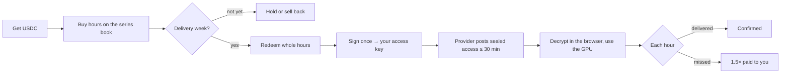

# For buyers

## What you're buying

A Silica token is one H100-80GB hour in one region and one ISO week. You can hold it, sell it back on the book, or redeem it in the delivery week for real GPU access. If the provider fails to deliver an hour, you're paid **1.5× that hour's price** from the provider's bond, automatically.

## The flow

## Your protections

| Risk | What protects you |
| --- | --- |
| The provider never gives you access | after 30 minutes anyone can call `slashUnserved`, and every hour is paid to you at 1.5× |
| The machine goes down during your hours | your probe signs the outage; the hour is slashed to you at 1.5× |
| The provider claims it delivered when it didn't | a confirmation needs your probe's signature too |
| The price moves after you redeem | your slash value is fixed at the mark when you redeemed (`priceAtOpen`) |
| Your credentials leak | they're sealed to a key only your wallet can derive, and decrypted only in your browser |

## Costs on testnet

| Item | Amount |
| --- | --- |
| Gas | testnet MON, a few cents' worth per transaction |
| USDC | free from the faucet (1,000 per hour) |
| Trading fee on SilicaBook | none |
| Minimum order | 10 USDC notional |
