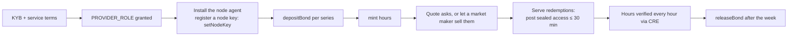

# For providers

## What you get

Pre-sell idle GPU capacity weeks ahead and get paid as it trades, with your bond doing the job a buyer's trust would otherwise have to do. A clean delivery record lowers the collateral you post.

## Onboarding (production design)



On testnet the two providers, NeoGPU and Basalt Cloud, are seeded wallets with simulated nodes.

## How much bond you need

```text
required = (minted − settled) × mark × bondRatio
```

| Your record | Ratio | Bond for 1,000 open hours at $2.05 |
| --- | --- | --- |
| ≥ 1,000 confirmed hours at ≥ 99% | 20% | $410 |
| new, or in between | 30% | $615 |
| ≥ 10 hours judged and < 95% reliability | 40% | $820 |

## What can go wrong for you

| Event | Consequence |
| --- | --- |
| You miss an hour | 1.5× its price paid from your bond to the holder; your reliability drops |
| You never post access | anyone can slash the whole ticket |
| Your bond falls below the requirement | **margin call**: you can't mint until you top up |
| Your reliability falls below 95% | your ratio rises to 40%, which may margin-call you |
| A dispute | the hour is held until an arbiter resolves it |

## The provider console

`/provider` shows your bond, minted, assigned and settled hours, mint headroom, your current ratio and reputation progress, and any margin call, with buttons to deposit, mint and register your node key.
