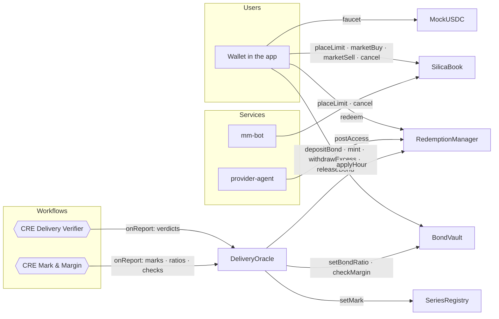
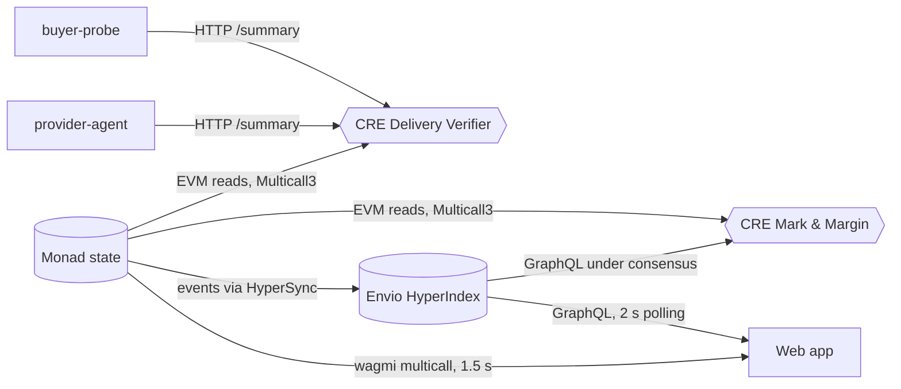
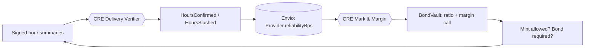

# Data flow

Silica has two read paths (the chain and Envio) and two write paths (users and CRE). This page shows which data travels where.

## Writes

## Reads

## What the app reads from where

| Screen | From the chain | From Envio |
| --- | --- | --- |
| Markets | marks, best bid/ask, supply | forward points, series stats |
| Trading | book depth, balances, allowances, Kuru book (once verified) | trade tape, price chart, open interest, bond locked, provider reliability |
| Tickets | live ticket state | ticket history, per-hour verdicts, sealed ciphertext |
| Provider | the connected provider's positions | delivery record, margin-call history |
| Status | oracle state (`simulationMode`, forwarder), contract addresses | CRE report log, protocol totals |

Live chain reads keep anything money-critical current to the block. Envio supplies everything historical or derived, which a single RPC call couldn't answer.

## The feedback loop

The most important flow is a loop: delivery evidence becomes a verdict, the verdict becomes reliability, reliability becomes collateral, and collateral constrains what a provider can sell next.

