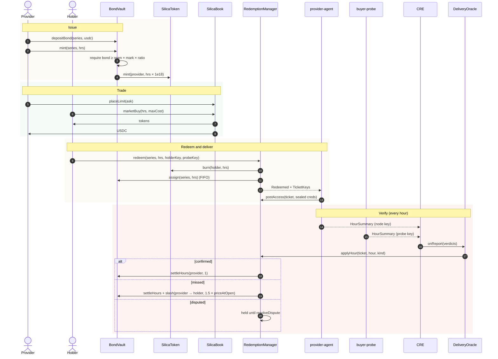

# Lifecycle of an hour

This page follows a single GPU-hour from the moment a provider mints it to the moment it settles, either to the provider (confirmed) or to the holder (slashed).

## The full sequence

## Timing on testnet

| Event | When |
| --- | --- |
| Redemption | any time inside the delivery week |
| Access deadline | `openedAt + 30 min` |
| Delivery hour `h` starts | `accessPostedAt + h × hourSeconds` |
| Delivery hour `h` can be judged | after `accessPostedAt + (h + 1) × hourSeconds` |
| `hourSeconds` | **300 s** on the W42 demo series (3,600 s in production) |
| Delivery Verifier cadence | every minute on testnet |
| Mark & Margin cadence | hourly in production (configurable on testnet) |

```mermaid
gantt
  title Ticket 7 on testnet, 5-minute hours, times approximate (UTC)
  dateFormat HH:mm
  axisFormat %H:%M
  section Ticket
  Access posted           :milestone, m1, 20:23, 1m
  Hour 0 (outage)         :crit, h0, 20:23, 5m
  Hour 1                  :h1, after h0, 5m
  Hour 2                  :h2, after h1, 5m
  section Verdicts
  Hour 0 missed via CRE   :milestone, v0, 20:29, 1m
  Hour 1 confirmed        :milestone, v1, 20:34, 1m
  Hour 2 confirmed        :milestone, v2, 20:39, 1m
```

## What each actor sees

| Actor | Sees |
| --- | --- |
| Holder | a ticket card with a per-hour timeline (green, red, amber), the slash paid to them, and decryptable access |
| Provider | its bond, minted, assigned and settled hours, ratio, margin status, and tickets it serves |
| Everyone | every report on `/status`, every event on Envio, every transaction on MonadVision |
