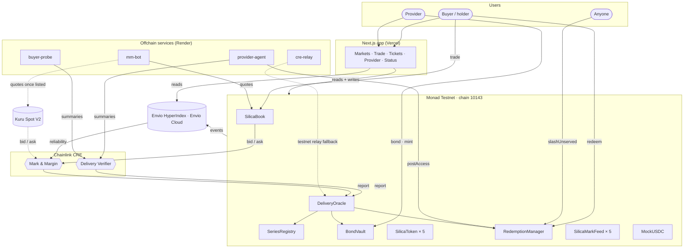
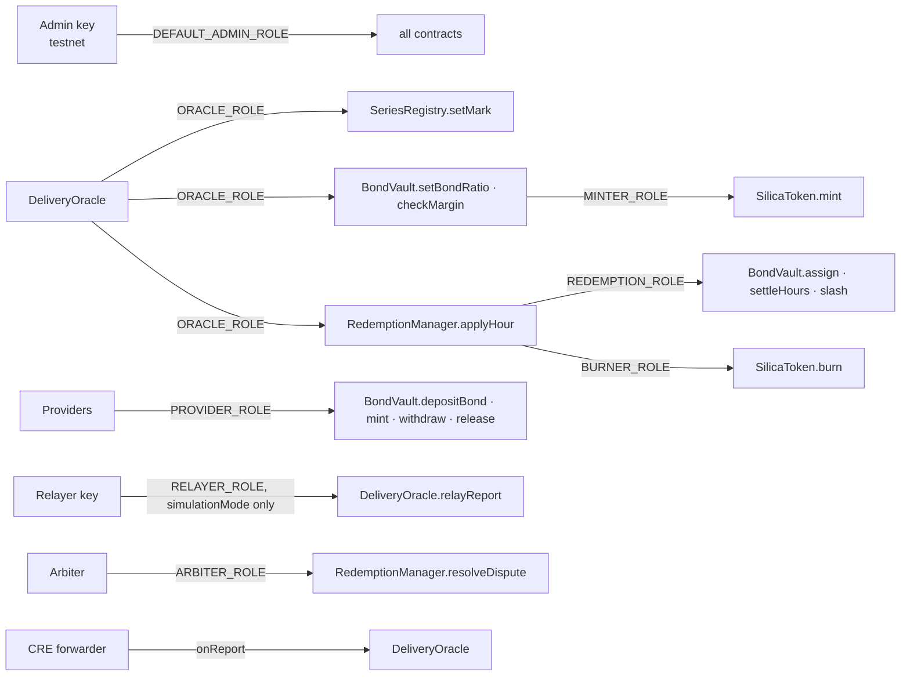

# System overview

Silica has four layers: **contracts on Monad** that hold every rule and every dollar, **offchain services** that deliver and witness GPU time, **Chainlink CRE** that brings evidence and market data onchain, and **Envio** that turns events into the data both CRE and the app read.

## Components

| Component | Where | Responsibility |
| --- | --- | --- |
| `SeriesRegistry` | contract | creates series and their tokens; stores marks |
| `BondVault` | contract | holds bonds, enforces the mint rule, assigns hours FIFO, slashes, margin-calls |
| `SilicaToken` | contract (one per series) | the GPU-hour token |
| `SilicaBook` | contract | price-time-priority order book with escrow |
| `RedemptionManager` | contract | redemptions, tickets, sealed access, applies hour verdicts and slashes |
| `DeliveryOracle` | contract | CRE `ReceiverTemplate` consumer; decodes reports, re-derives verdicts, routes marks, ratios and margin checks |
| `SilicaMarkFeed` | contract (one per series) | Kuru-compatible USD price feed serving the CRE mark |
| `MockUSDC` | contract | testnet quote and bond token with a public faucet |
| `provider-agent` | service | simulated GPU node: posts sealed access, signs hourly summaries |
| `buyer-probe` | service | independent witness: checks the delivered host, signs its own summary |
| `mm-bot` | service | quote-only market maker on SilicaBook (and Kuru once listed) |
| `cre-relay` | service | runs the CRE simulations on a schedule, or relays the same report bytes on testnet |
| Delivery Verifier | CRE workflow | turns signed evidence into verdict reports |
| Mark & Margin | CRE workflow | turns book prices and Envio reliability into marks, ratios and margin checks |
| Envio indexer | Envio Cloud | indexes 23 events into 13 entities served over GraphQL |
| Web app | Vercel | trading, redemption, provider console, proof page |

## Roles and permissions

| Role | Held by | Can |
| --- | --- | --- |
| `ORACLE_ROLE` | `DeliveryOracle` | set marks, set bond ratios, run margin checks, apply hour verdicts |
| `REDEMPTION_ROLE` | `RedemptionManager` | assign hours, settle hours, slash bonds |
| `MINTER_ROLE` / `BURNER_ROLE` | `BondVault` / `RedemptionManager` | mint and burn series tokens |
| `PROVIDER_ROLE` | allowlisted providers (KYB in production) | bond, mint, withdraw excess, release |
| `RELAYER_ROLE` | testnet relayer key | `relayReport`, **only while `simulationMode` is on** |
| `ARBITER_ROLE` | admin on testnet | `resolveDispute` |
| `DEFAULT_ADMIN_ROLE` | admin key on testnet | parameters, roles, forwarder address |

## Where each kind of state lives

| State | Source of truth | Read by the app from |
| --- | --- | --- |
| Bonds, positions, margin flags | `BondVault` | chain (wagmi multicall) |
| Marks | `SeriesRegistry` | chain |
| Book depth and best bid/ask | `SilicaBook` | chain |
| Trades, candles, the trade tape | `SilicaBook` events | Envio |
| Tickets and per-hour verdicts | `RedemptionManager` | chain + Envio |
| Provider reliability | derived from events | Envio |
| CRE report history | `DeliveryOracle` events | Envio |
