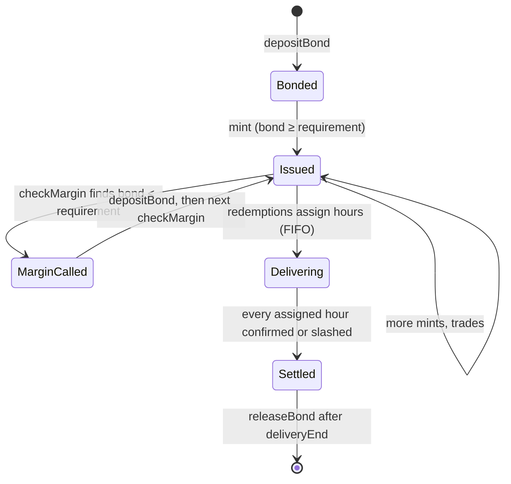

# Bonds and minting

A provider can only create hours it has collateralized. The bond is USDC locked in `BondVault`, per provider and per series, and it is the money that pays buyers when delivery fails.

## The mint rule

```text
bond  ≥  (minted − settled + newHours) × markPrice × bondRatio
```

- **minted − settled** is the provider's open obligation: hours it has issued that haven't yet been confirmed or slashed.
- **markPrice** is the series' current mark, set by CRE.
- **bondRatio** is 30% by default, and moves with the provider's [reputation](/concepts/reputation).

`BondVault.mint` checks the rule and reverts with `BondTooLow(required, have)` if it fails, and with `MarginCalled()` if the provider is currently margin-called.

### Example

A provider wants to mint 1,000 W44 hours at a $2.00 mark, at the default 30% ratio:

| | Value |
| --- | --- |
| Notional | 1,000 × $2.00 = $2,000 |
| Required bond | $2,000 × 30% = **$600** |
| Hours a fully used bond covers | $600 ÷ ($2.00 × 1.5) = **200 missed hours** |

## The position

Each provider has one `Position` per series:

| Field | Meaning |
| --- | --- |
| `bond` | USDC locked |
| `minted` | hours issued |
| `assigned` | hours handed to tickets by redemptions |
| `settled` | hours confirmed or slashed |
| `marginCalled` | `true` while the bond is below the requirement |



## Moving collateral

| Function | When | Rule |
| --- | --- | --- |
| `depositBond(seriesId, amount)` | any time | adds USDC to the position |
| `mint(seriesId, hrs)` | before `deliveryEnd` | mint rule above; not while margin-called |
| `withdrawExcess(seriesId, amount)` | any time | only what's above the current requirement |
| `releaseBond(seriesId)` | after `deliveryEnd` | only when `assigned == settled` (no open tickets) |

## FIFO assignment

When a holder redeems, `BondVault.assign` hands the hours to providers **in the order they first minted** that series, using each provider's unassigned capacity (`minted − assigned`). If one provider can't cover the whole redemption, the remainder goes to the next. Each provider that takes hours gets its own ticket, so one provider's failure never affects hours delivered by another.
