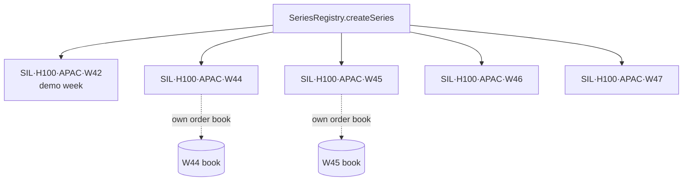

# The GPU-hour token

A Silica token is the right to **one hour of one GPU model, in one region, in one ISO week**. It is an ERC-20 (`SilicaToken`) with 18 decimals, and `1e18` units equal exactly one hour.

| Property | Value |
| --- | --- |
| Standard | ERC-20 (`contracts/src/SilicaToken.sol`) |
| Decimals | 18 (`HOUR_UNIT = 1e18` = one hour) |
| Example symbol | `SIL-H100-APAC-W42` (shown as `SIL·H100·APAC·W42`) |
| Who can mint | only `BondVault` (`MINTER_ROLE`), and only against a bond |
| Who can burn | only `RedemptionManager` (`BURNER_ROLE`), when a holder redeems |
| Backing | the issuing provider's USDC bond for that series |
| Settlement | physical: the holder receives GPU access, or is paid from the bond |

## One token per series

Every series has its own token contract, deployed by `SeriesRegistry.createSeries`. Tokens of different series are different assets: a W44 hour is not a W45 hour, the same way a December futures contract is not a March one. That is what lets each series have its own order book and its own price.

## What the holder can do

1. **Hold** it as a forward position on compute.
2. **Trade** it on the series' order book at any time before the delivery week ends.
3. **Redeem** it during the delivery week, in whole hours, for a delivery ticket and real GPU access.

Tokens that are not redeemed by Sunday 23:59 UTC of their delivery week expire: the delivery window has closed and the provider's obligation for that week ends.

## Why it's a token at all

- **Transferable:** a team that over-bought can sell hours back on the book instead of wasting them.
- **Composable:** the same token can later serve as collateral elsewhere (see the [roadmap](/reference/roadmap)).
- **Fungible within a series:** any W44 hour is as good as any other, because every hour in a series is backed by the same rules and verified the same way.
