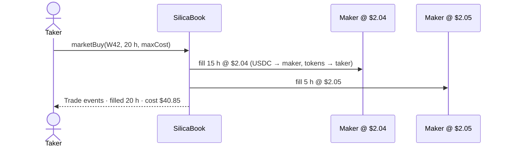

# The order book

Each series trades on **SilicaBook**, a fully onchain, price-time-priority limit order book. Kuru Spot V2 books are prepared for every series and switch on automatically once Kuru lists them (see [Kuru](/integrations/kuru)).

## Rules

| Rule | Value |
| --- | --- |
| Matching | price-time priority, FIFO within a price level |
| Tick size | `$0.01` (`TICK = 10_000` in 6-decimal USDC) |
| Minimum order | 10 USDC notional (`MIN_NOTIONAL`), the same floor as Kuru |
| Size unit | whole hours (`uint32 hrs`) |
| Fills per transaction | at most 20 (`MAX_FILLS`), to bound gas |
| Self-trades | rejected (`SelfTrade()`) |
| Escrow | bids lock USDC, asks lock tokens, both inside the book |

## Functions

| Function | What it does |
| --- | --- |
| `placeLimit(seriesId, isBid, price, hrs)` | matches against the opposite side first, then rests the remainder. Returns `(orderId, filled)`. |
| `marketBuy(seriesId, hrs, maxCost)` | takes asks up to `hrs`, reverting with `Slippage` if the cost exceeds `maxCost` |
| `marketSell(seriesId, hrs, minProceeds)` | hits bids, reverting with `Slippage` if proceeds fall below `minProceeds` |
| `cancel(orderId)` | owner only; refunds the escrow |
| `bestBidAsk(seriesId)` | top of book, used by CRE for the mark |
| `depth(seriesId, n)` | the best `n` levels per side |
| `levelOrders(seriesId, isBid, price, max)` | the order ids resting at one level |

## How a market buy fills

## Events

- `OrderPlaced(orderId, seriesId, owner, isBid, price, hrs)`
- `OrderCancelled(orderId, seriesId, remaining)`
- `Trade(seriesId, makerOrderId, maker, taker, takerBuys, hrs, price)`

Envio indexes all three into `Order`, `Level`, `Trade` and 1-hour `Candle` entities, which power the app's order book, trade tape and price chart.

## Liquidity on testnet

The book is seeded by a **quote-only market maker** (two levels a side around the CRE mark) and by the provider's own **asks** further out. Fills come from separately labelled test-buyer wallets. The market maker never takes liquidity, and the book rejects self-trades. See [Market maker](/services/market-maker).
