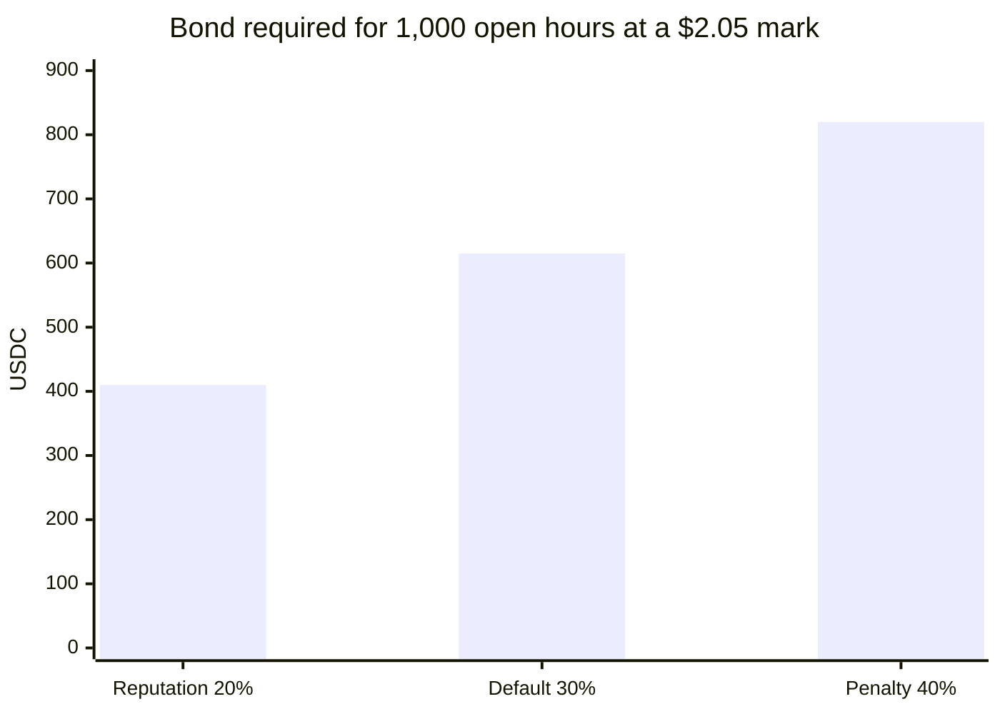
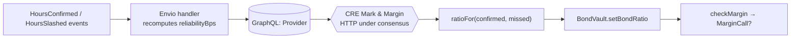

# Reputation and bond ratios

A provider's bond ratio follows its delivery record. Reliable providers post less collateral; unreliable ones post more. The record comes from **Envio**, and the ratio is written onchain by **Chainlink CRE**.

## The tiers

```text
reliability = confirmed / (confirmed + missed)
```

| Tier | Condition | Bond ratio |
| --- | --- | --- |
| **Reputation** | ≥ 1,000 confirmed hours **and** reliability ≥ 99% | **20%** |
| **Default** | everyone else, including new providers | **30%** |
| **Penalty** | ≥ 10 delivered-or-missed hours **and** reliability < 95% | **40%** |



- The **10-hour minimum** stops a single early miss from triggering the penalty on a new provider.
- The ratio applies per position: `BondVault.bondRatioOf(provider, seriesId)` returns the override if CRE set one, otherwise the series default.
- Raising a ratio can margin-call a provider straight away, because the requirement rises while the bond doesn't.

## Worked examples

| Confirmed | Missed | Reliability | Ratio |
| --- | --- | --- | --- |
| 0 | 0 | n/a (new) | 30% |
| 9 | 0 | 100% | 30% (not enough history for a tier) |
| 10 | 4 | 71.4% | **40%** |
| 100 | 4 | 96.2% | 30% |
| 1,000 | 5 | 99.5% | **20%** |

## Where it's computed

The same function, `ratioFor(confirmed, missed)` in `packages/shared/src/units.ts`, is compiled into the CRE Mark & Margin workflow and used by the testnet relay, so both paths always produce identical ratios.


