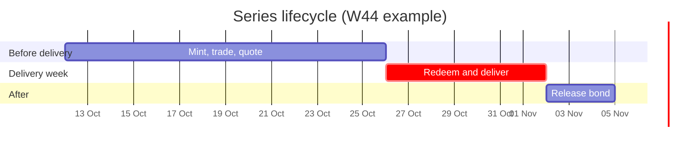
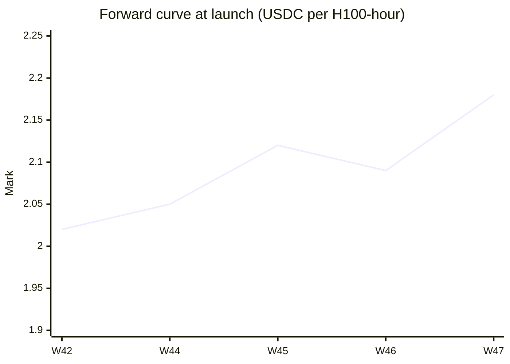

# Series and delivery weeks

A **series** is one standardized contract: a GPU model, a region and an ISO delivery week. Everything else in Silica (the token, the order book, the mark, every bond position) hangs off a series id.

## What a series stores

`SeriesRegistry` keeps one `Series` struct per series:

| Field | Type | Meaning |
| --- | --- | --- |
| `gpu` | `bytes32` | GPU model, e.g. `H100-80GB` |
| `region` | `bytes32` | delivery region, e.g. `APAC` |
| `deliveryStart` | `uint64` | Monday 00:00 UTC of the ISO week |
| `deliveryEnd` | `uint64` | Sunday 23:59:59 UTC of the same week |
| `bondRatioBps` | `uint16` | default bond ratio, `3000` = 30% |
| `slashMultBps` | `uint16` | payout multiple for a missed hour, `15000` = 1.5× |
| `token` | `address` | the series' `SilicaToken` |
| `markPrice` | `uint128` | USDC per GPU-hour (6 decimals), written by CRE |
| `markUpdatedAt` | `uint64` | the `scheduledAt` of the report that last set the mark |

## The delivery window

| Phase | What's allowed |
| --- | --- |
| Before `deliveryStart` | mint (with bond), trade, quote. Redemption reverts with `OutsideDeliveryWindow`. |
| `deliveryStart` → `deliveryEnd` | everything above, plus **redeem** and delivery. |
| After `deliveryEnd` | no more minting or redemption. Providers call `releaseBond` once every assigned hour has settled. |

## Testnet series

| Series | Delivery week | Starting mark | Role |
| --- | --- | --- | --- |
| `SIL·H100·APAC·W42` | 12–18 Oct 2026 | $2.02 | **demo week**, live for redemption now, 5-minute delivery hours |
| `SIL·H100·APAC·W44` | 26 Oct – 1 Nov | $2.05 | forward curve |
| `SIL·H100·APAC·W45` | 2–8 Nov | $2.12 | forward curve |
| `SIL·H100·APAC·W46` | 9–15 Nov | $2.09 | forward curve |
| `SIL·H100·APAC·W47` | 16–22 Nov | $2.18 | forward curve |

::: info Why a demo week
W44–W47 only start delivering on 26 October, so nothing in them could be redeemed during judging. The W42 series covers the current week so the full redeem → deliver → verify → slash path can be tried live. On testnet one delivery hour is 5 minutes (`RedemptionManager.hourSeconds = 300`).
:::
