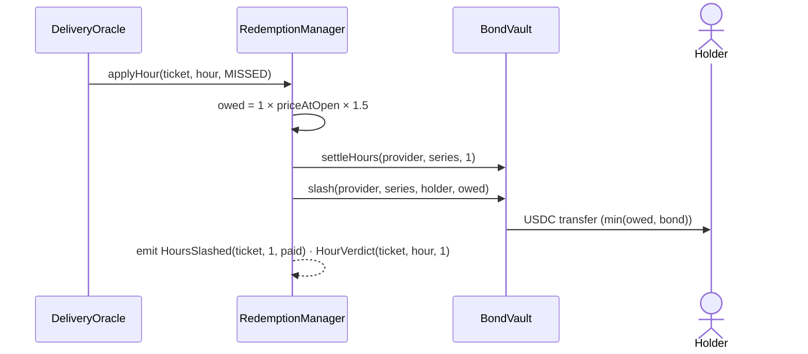

# Slashing and disputes

## Slashing

A missed hour pays the holder from the provider's bond, in the same transaction that records the verdict.

```text
payout = missedHours × priceAtOpen × slashMult        (slashMult = 1.5×)
paid   = min(payout, remaining bond for that provider and series)
```

- `priceAtOpen` is the mark when the holder redeemed, so the payout can't be gamed by moving the mark afterwards.
- A slash also **settles** those hours, so they stop counting against the provider's bond requirement.
- The payout is capped at the bond that remains. The [margin system](/concepts/mark-and-margin) exists so the bond is never allowed to fall far below what open hours need.



### Three ways an hour gets slashed

| Trigger | Who calls | Hours slashed |
| --- | --- | --- |
| A **missed** verdict from CRE | `DeliveryOracle` | that hour |
| Access never posted by the deadline | **anyone**, via `slashUnserved` | every remaining hour on the ticket |
| A dispute resolved as missed | `ARBITER_ROLE`, via `resolveDispute` | the hours resolved as missed |

### Live examples on testnet

| Ticket | What happened | Paid to the buyer |
| --- | --- | --- |
| #2 | 2 hours missed during a demo outage, at a $2.02 mark | **$6.06** = 2 × $2.02 × 1.5 |
| #7 | 1 hour missed, judged by `cre workflow simulate delivery-verifier --broadcast`, at a $2.03 mark | **$3.05** (3.045) |

## Disputes

When the two witnesses disagree, or only one side produced a valid summary, the hour is **disputed**. It is neither paid nor slashed: it is held.

```solidity
resolveDispute(uint256 ticketId, uint32 toConfirmed, uint32 toMissed)   // ARBITER_ROLE
```

The arbiter moves disputed hours to confirmed (they settle to the provider) or to missed (they are slashed to the holder). It cannot resolve more hours than are disputed (`TooManyResolved`).

::: warning Not finished
On testnet the arbiter is the admin key, and there is no dispute UI. The production design is a review process with evidence from both witnesses. See [Limitations](/reference/limitations).
:::
