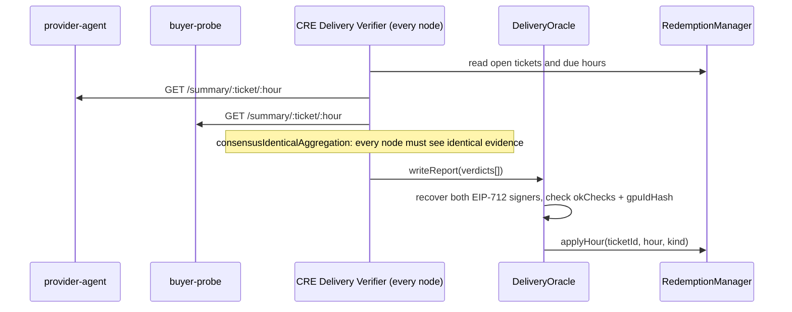
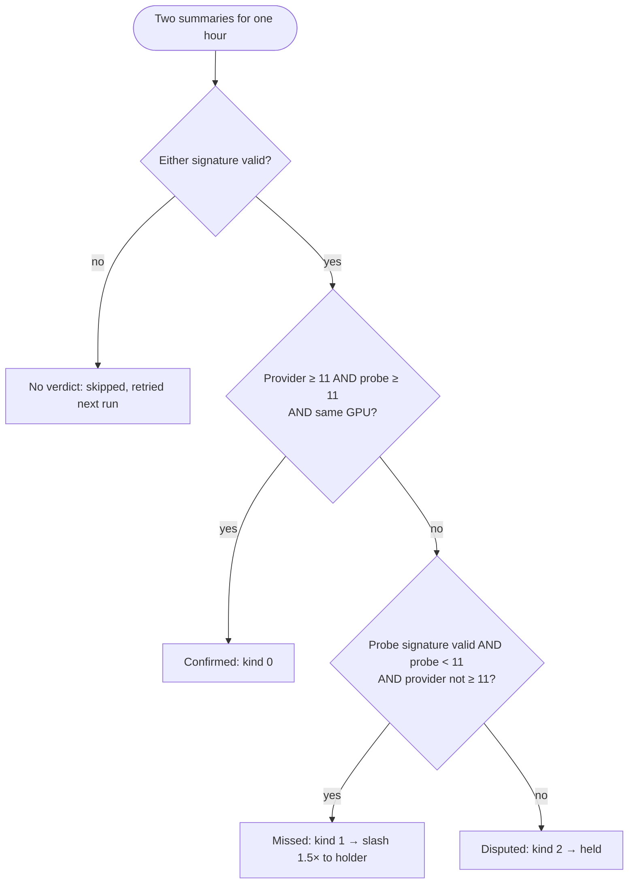

# Delivery verification

Every delivery hour is judged from **two independent, signed witnesses**: the provider's own node and a probe acting for the buyer. Neither side can grade itself, and the contract, not a server, decides the outcome.

## The two witnesses

| | Provider node | Buyer probe |
| --- | --- | --- |
| Runs | on the provider's side (`provider-agent`) | independently (`buyer-probe`) |
| Checks | its own GPU host via `nvidia-smi` | the delivered host from the outside: reachability and GPU identity |
| Signs with | the provider's registered **node key** (`setNodeKey`) | the ticket's **probe key** |
| Produces | one `HourSummary` per ticket-hour | one `HourSummary` per ticket-hour |

## Heartbeats and the hour summary

Each side samples its checks **14 times per delivery hour** (every `hourSeconds / 14` seconds) and counts at most **12** successes. Sampling 14 and capping at 12 means timer jitter or a late first sample never costs a healthy host a check.

At the end of the hour each side signs an EIP-712 message:

```solidity
// domain: name "Silica", version "1", chainId 10143, verifyingContract DeliveryOracle
HourSummary(uint256 ticketId, uint32 hour, uint8 okChecks, bytes32 gpuIdHash)
```

- `okChecks`: 0–12 successful checks in that hour.
- `gpuIdHash`: a hash of the GPU's identity, so both sides must be looking at the **same** GPU.

## Getting the evidence onchain



## The verdict rule

`DeliveryOracle._derive()` turns the two summaries into one of four outcomes:



| Provider node | Buyer probe | Outcome |
| --- | --- | --- |
| ≥ 11/12 | ≥ 11/12, same GPU | **confirmed** |
| < 11, or no summary at all | valid and < 11 | **missed** |
| ≥ 11 | < 11 | **disputed** (they disagree) |
| valid | missing or invalid | **disputed** (one side only) |
| ≥ 11 | ≥ 11, different GPU | **disputed** (GPU mismatch) |
| invalid | invalid | **no verdict** |

A dead node can't sign, which is exactly why "provider absent + probe saw the outage" counts as missed rather than disputed.

## Idempotence and timing

- `applyHour` reverts with `HourNotElapsed` if the hour hasn't ended (`accessPostedAt + (hour + 1) × hourSeconds`), and with `VerdictAlreadyApplied` if that hour was already judged.
- Inside one report, each verdict is applied in its own `try/catch`. One bad verdict emits `VerdictSkipped(ticketId, hour, reason)` instead of reverting the whole report.
- Every report carries the **chain selector** and a strictly increasing **`scheduledAt`**, so a report can't be replayed on another chain or replayed later on this one.
