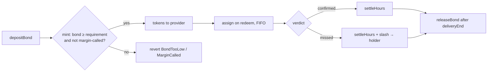

# BondVault

`contracts/src/BondVault.sol` · holds every provider's bond, enforces the mint rule, assigns redemptions FIFO, and pays slashes. `ReentrancyGuard` + `SafeERC20` throughout.

## Provider functions (`PROVIDER_ROLE`)

| Function | Description | Reverts with |
| --- | --- | --- |
| `depositBond(seriesId, amount)` | locks USDC in the position | `ZeroAmount` |
| `mint(seriesId, hrs)` | mints `hrs × 1e18` tokens if `bond ≥ (minted − settled + hrs) × mark × ratio` | `ZeroAmount`, `OutsideDeliveryWindow`, `MarginCalled`, `BondTooLow(required, have)` |
| `withdrawExcess(seriesId, amount)` | withdraws bond above the current requirement | `ZeroAmount`, `BondTooLow` |
| `releaseBond(seriesId)` | withdraws the whole bond after the delivery week | `DeliveryNotOver`, `OpenTickets`, `ZeroAmount` |

## Oracle functions (`ORACLE_ROLE`, called by `DeliveryOracle`)

| Function | Description |
| --- | --- |
| `checkMargin(provider, seriesId)` | sets or clears `marginCalled` and emits `MarginCall(shortfall)` / `MarginCleared` |
| `setBondRatio(provider, seriesId, bondRatioBps)` | per-position ratio override from reputation (`InvalidRatio` above 100%) |

## Redemption functions (`REDEMPTION_ROLE`, called by `RedemptionManager`)

| Function | Description |
| --- | --- |
| `assign(seriesId, hrs)` | splits a redemption across providers in FIFO mint order; returns `(providers[], amounts[])`; `InsufficientCapacity` if not enough unassigned hours exist |
| `settleHours(provider, seriesId, hrs)` | marks hours confirmed or slashed, lowering the bond requirement |
| `slash(provider, seriesId, to, amount)` | pays `min(amount, bond)` to the holder; returns the amount paid |

## Views

| View | Returns |
| --- | --- |
| `positionOf(provider, seriesId)` | `Position { bond, minted, assigned, settled, marginCalled }` |
| `bondRatioOf(provider, seriesId)` | the override if set, else the series default |
| `requiredBond(provider, seriesId)` | `(minted − settled) × mark × ratio` |
| `mintableHours(provider, seriesId)` | extra hours the current bond would allow |
| `providersInQueue(seriesId)` | providers in FIFO order |

## Events

`BondDeposited` · `Minted` · `MarginCall` · `MarginCleared` · `BondReleased` · `BondSlashed(provider, seriesId, to, amount)` · `BondRatioSet` · `HoursAssigned` · `HoursSettled`

## Errors

`NotProvider` · `BondTooLow(required, have)` · `MarginCalled` · `ZeroAmount` · `OutsideDeliveryWindow` · `DeliveryNotOver` · `OpenTickets` · `InsufficientCapacity(requested, available)` · `InvalidRatio`

## Constants

| Constant | Value |
| --- | --- |
| `BPS` | `10_000` |
| `HOUR_UNIT` | `1e18`, one hour of token |

