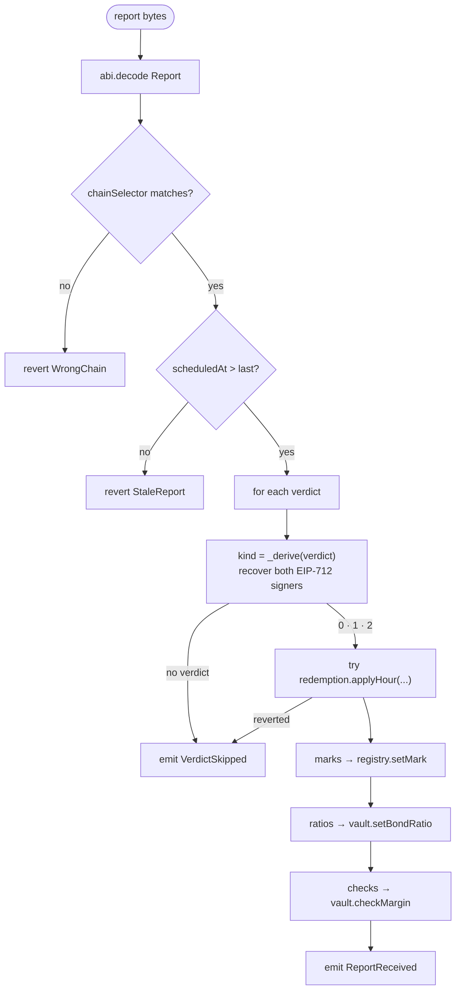

# DeliveryOracle

`contracts/src/DeliveryOracle.sol` · the Chainlink CRE consumer. It inherits `ReceiverTemplate` (adapted from the CRE consumer-contract docs), `AccessControl` and OpenZeppelin `EIP712`, and it is the **only** contract that can apply verdicts, set marks, set ratios or run margin checks.

## Entry points

| Function | Who | Description |
| --- | --- | --- |
| `onReport(metadata, report)` | the configured CRE forwarder | the production path. `ReceiverTemplate` checks the sender is the forwarder, then hands the bytes to `_processReport` |
| `relayReport(report)` | `RELAYER_ROLE`, **only while `simulationMode` is on** | the testnet fallback; same report bytes, same processing; flagged `relayed = true` |
| `setSimulationMode(enabled)` | admin | turns the relay path on or off |
| `setChainSelector(selector)` | admin | the chain selector reports must carry (`2183018362218727504` for Monad Testnet) |
| `setForwarderAddress(forwarder)` | owner | points at the CRE forwarder (mock in simulation, `KeystoneForwarder` in production) |

## The report

```solidity
struct Report {
  uint64 chainSelector;   // rejects cross-chain replay
  uint64 scheduledAt;     // cron slot; must increase; rejects same-chain replay
  Verdict[] verdicts;     // Delivery Verifier
  Mark[] marks;           // Mark & Margin
  Ratio[] ratios;         // Mark & Margin
  MarginCheck[] checks;   // Mark & Margin
}
struct Verdict {
  uint256 ticketId; uint32 hour;
  uint8 providerOk; bytes32 providerGpu; bytes providerSig;   // empty sig = node produced no summary
  uint8 probeOk;    bytes32 probeGpu;    bytes probeSig;
}
struct Mark        { uint256 seriesId; uint128 price; }
struct Ratio       { address provider; uint256 seriesId; uint16 bondRatioBps; }
struct MarginCheck { address provider; uint256 seriesId; }
```

## Processing



## Signature checks

```solidity
bytes32 HOUR_SUMMARY_TYPEHASH =
  keccak256("HourSummary(uint256 ticketId,uint32 hour,uint8 okChecks,bytes32 gpuIdHash)");
// EIP-712 domain: name "Silica", version "1"
```

- the **provider** summary must be signed by the ticket's `nodeKey`;
- the **probe** summary must be signed by the ticket's `probeKey`;
- `okChecks` must be ≤ `CHECKS_PER_HOUR` (12); `OK_THRESHOLD` is 11.

The full verdict rule is on [Delivery verification](/concepts/verification#the-verdict-rule). Two helper views expose it: `deriveKind(verdict)` and `hourDigest(ticketId, hour, okChecks, gpuIdHash)`.

## Events and errors

| Event | Meaning |
| --- | --- |
| `ReportReceived(scheduledAt, verdicts, applied, marks, ratios, checks, relayed)` | one per report; `relayed` says which path delivered it |
| `VerdictSkipped(ticketId, hour, reason)` | a verdict was unsigned, invalid, or rejected by the redemption manager |
| `SimulationModeSet(enabled)` · `ChainSelectorSet(selector)` | configuration |

Errors: `WrongChain(selector)` · `StaleReport(scheduledAt, last)` · `SimulationOff()`.
