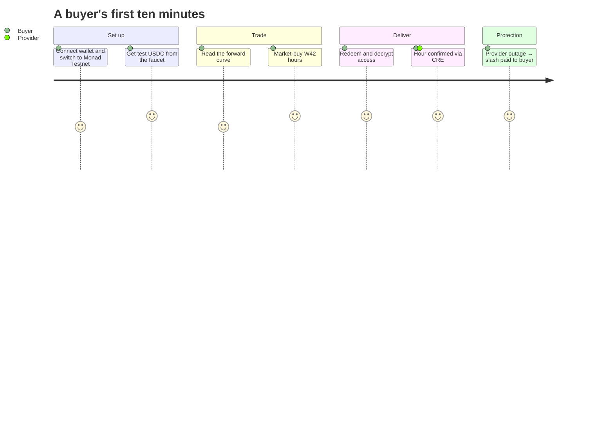

# Quickstart

Try Silica end to end on Monad Testnet in about ten minutes. You'll buy GPU-hours, redeem them, decrypt your access, watch an hour get verified, and then trigger an outage and get paid from the provider's bond.

::: tip Testnet only
Everything here uses test MON and test USDC. No real money is involved.
:::

## 1 · Connect a wallet

1. Install a browser wallet such as MetaMask, ideally in a fresh browser profile.
2. Add **Monad Testnet**: chain ID `10143`, RPC `https://testnet-rpc.monad.xyz`, currency `MON`. The app also offers to switch for you.
3. Get a little testnet MON from the [Monad faucet](https://faucet.monad.xyz) for gas.
4. Open **[silica-monard.vercel.app](https://silica-monard.vercel.app)** and click **Connect wallet**.

## 2 · Get test USDC

On any market page, press **Get test USDC**. The `MockUSDC` faucet sends 1,000 USDC per wallet per hour.

## 3 · Look at the market

Open **/markets**. You'll see the **forward curve**: one point per weekly series, priced at the mark Chainlink CRE last wrote. Below it, a card per series shows its mark, open interest and bond.

## 4 · Buy hours

Open **/markets/h100-apac-w42**, the live demo week.

- The **order book** shows the market maker's ladder and the provider's own asks.
- The **Bond & risk** panel shows how much bond stands behind the open hours, and each provider's reliability from Envio.
- Choose **Market**, pick an amount (minimum 10 USDC notional), and press **Buy**. The fill confirms on Monad in about a second.

## 5 · Redeem

Open **/tickets**, pick the W42 series and the number of hours, and press **redeem()**.

- Your tokens are burned and a **ticket** opens with a provider.
- You sign one message (no gas). It derives the key your access is sealed to.
- Within about a minute the provider posts your access onchain. Press **Decrypt with wallet** to read the SSH credentials, decrypted locally in your browser.

## 6 · Watch delivery

Each delivery hour lasts **5 minutes** on the demo series. At the end of each hour, the provider's node and the independent buyer probe each sign a report, CRE brings both onchain, and the hour turns **green** (confirmed) on your ticket's timeline.

## 7 · Trigger an outage

Under **Delivery evidence · demo controls**, press **Provider outage**. The simulated provider's host goes down. At the end of the next hour the probe reports the outage, the hour turns **red** (missed), and **1.5× the hour's price** is paid to your wallet from the provider's bond. Press **Both up** to restore service.

## 8 · Check the proof

Open **/status**: every contract address with explorer links, each oracle report with the path it took (Chainlink CRE forwarder or the labelled testnet relay), Kuru listing status, and sample transactions.

