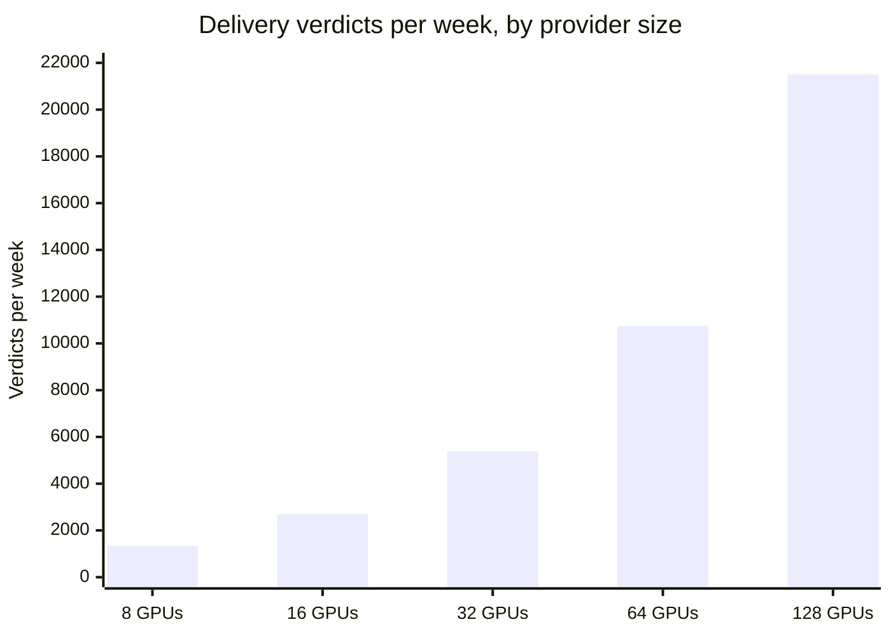

# Why Silica

## The problem

GPU time is the input that every AI team plans around, and it is bought almost entirely on the spot market.

- **Buyers can't plan.** A team that knows it needs a hundred H100 hours for a training run next month can't lock that price or that capacity today. It pays whatever the hour costs on the day, if it can get the hour at all.
- **Small providers can't sell ahead.** A neocloud or reseller with idle machines would happily pre-sell next month's hours and get paid now. But a buyer has no reason to prepay a provider it has never heard of: if delivery fails, the buyer's only recourse is a support ticket.
- **The exchanges don't deliver.** CME, ICE with Ornn, Kalshi and Injective have started listing compute products. Every one of them is cash-settled on a price index. They let you bet on the price of compute; none of them gives you a GPU, and none of them protects you if a provider fails.

## The gap

| | Price locked in advance | Real GPU delivered | Buyer protected if delivery fails |
| --- | :---: | :---: | :---: |
| Spot GPU clouds | no | yes | no |
| Reserved instances (hyperscalers) | yes | yes | contract terms, slow |
| Cash-settled compute futures | yes | **no** | n/a |
| **Silica** | **yes** | **yes** | **yes, automatically, from the bond** |

## The idea

Make the GPU-hour itself the traded asset, and make the provider's own money the guarantee.

1. **Standardize** the hour: one GPU model, one region, one ISO week. Every hour in a series is interchangeable, so it can trade on an order book.
2. **Collateralize** it: a provider can only mint against a USDC bond sized to the hours it has outstanding.
3. **Verify** it: two independent parties sign what they saw every hour, and the contract, not a human, decides what happened.
4. **Enforce** it: a missed hour pays the holder 1.5× its price from the bond, in the same transaction that records the verdict.

The bond replaces trust. A buyer doesn't need to know the provider: the provider has already posted the money that pays the buyer if it fails.

## Why Monad

Delivery verification is a high-frequency, high-cardinality workload.

- One provider with **64 GPUs** produces **64 verdicts an hour**, or **10,752 a week**, each one a transaction that can move money.
- **Every GPU × region × week is its own order book.** A modest catalogue (3 GPUs × 3 regions × 4 weeks) is already 36 live books.
- That is only affordable at Monad's throughput and fees, and **400 ms blocks with 800 ms finality** make the book feel like an exchange rather than a batch auction.

## Why now

AI teams' spend on compute keeps growing, and the providers serving them are increasingly small and regional. Both sides already want forward contracts; the exchanges listing cash-settled compute products show the appetite for compute exposure. What's missing is the delivery and the guarantee, and that is exactly the part a programmable, collateralised market can provide.
