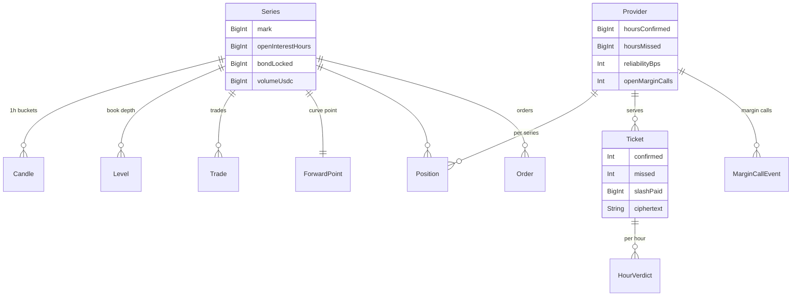
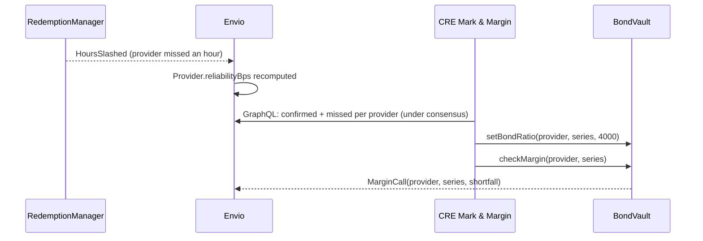

# Envio HyperIndex

**Envio is Silica's read layer**, and its data drives the protocol's collateral rules, not just the UI. HyperIndex v3 indexes Silica's five protocol contracts over **HyperSync** into one GraphQL API hosted on **Envio Cloud**.

- Endpoint: `https://indexer.dev.hyperindex.xyz/581ef33/v1/graphql`
- Source: `indexer/config.yaml` (generated from the deployment addresses), `indexer/schema.graphql`, `indexer/src/EventHandlers.ts`

## What's indexed

| Contract | Events |
| --- | --- |
| SeriesRegistry | `SeriesCreated`, `MarkUpdated` |
| BondVault | `BondDeposited`, `Minted`, `MarginCall`, `MarginCleared`, `BondReleased`, `BondSlashed`, `BondRatioSet`, `HoursSettled` |
| RedemptionManager | `Redeemed`, `TicketKeys`, `AccessPosted`, `HoursConfirmed`, `HoursSlashed`, `HoursDisputed`, `HourVerdict`, `TicketSettled`, `NodeKeySet` |
| DeliveryOracle | `ReportReceived` |
| SilicaBook | `OrderPlaced`, `OrderCancelled`, `Trade` |

**5 contracts · 23 events · 13 entities.**

## The entities



Plus `CreReport` (every oracle report and the path it took) and `Stats` (protocol totals).

## Derived, not mirrored

The handlers compute what the product needs instead of copying raw logs:

```ts
indexer.onEvent({ contract: "RedemptionManager", event: "HoursSlashed" }, async ({ event, context }) => {
  const t = await context.Ticket.getOrThrow(event.params.ticketId.toString());
  const p = await provider(context, t.provider_id);
  const missed = p.hoursMissed + BigInt(event.params.hrs);
  context.Ticket.set({ ...t, missed: t.missed + Number(event.params.hrs), slashPaid: t.slashPaid + event.params.payout });
  context.Provider.set({ ...p, hoursMissed: missed, reliabilityBps: reliability(p.hoursConfirmed, missed) });
});
```

- **Reliability** is recomputed on every `HoursConfirmed` and `HoursSlashed`: `confirmed × 10,000 / (confirmed + missed)`.
- **Open interest** = minted − redeemed; **volume** and **1-hour candles** from `Trade`; **book levels** from placed, filled and cancelled orders.
- **Margin calls** open and close with `MarginCall` / `MarginCleared`.

## Feature 1: Envio sets the collateral



This loop ran live on testnet: NeoGPU's record in Envio fell below 95% (13 confirmed, 8 missed: 61.9%), CRE raised its ratio to 40%, and four `MarginCallEvent`s came straight back into the index (tx [`0x8dc3…19b0`](https://testnet.monadvision.com/tx/0x8dc3ab5edb43d9b5952eb7aa158c214cfd487960ed1dc2076c9e5efb2dfa19b0)).

## Feature 2: everything users see

| Screen | Entities used |
| --- | --- |
| Trading | `Trade` (trade tape and price chart), `Series` (open interest, bond locked), `Provider` + `Position` (risk panel) |
| Markets | `Series`, `ForwardPoint` |
| Tickets | `Ticket` + `HourVerdict` (per-hour timeline), `Ticket.ciphertext` (decrypted in the browser) |
| Status | `CreReport` (report log and path), `Stats` |

## Try it

```graphql
{
  Provider(order_by: {reliabilityBps: asc}) {
    id hoursConfirmed hoursMissed reliabilityBps openMarginCalls bondSlashed
  }
}
```

```graphql
{
  Ticket(order_by: {openedAt: desc}, limit: 3) {
    id hours confirmed missed slashPaid status
    verdicts(order_by: {hour: asc}) { hour kind txHash }
  }
}
```

## Running the indexer

```bash
node indexer/gen-config.mjs            # HyperSync (needs ENVIO_API_TOKEN locally)
RPC_ONLY=1 node indexer/gen-config.mjs # public RPC only, no token
cd indexer && pnpm codegen && pnpm dev # Postgres + Hasura via Docker
```

On Envio Cloud the indexer deploys from the `envio` branch with the root directory set to `indexer`.
