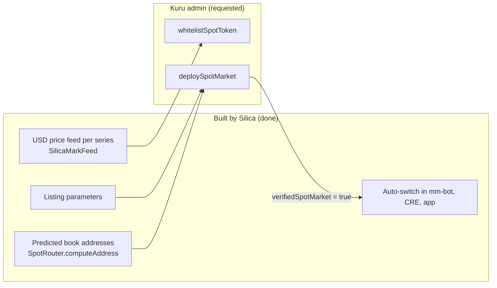

# Kuru Spot V2

Silica brings a **new asset class** to Kuru: deliverable compute. Each series token is meant to trade on its own Kuru Spot V2 book.

Kuru market creation and the token whitelist are **admin-only**: `whitelistSpotToken` reverts `Unauthorized()` for outside callers, and we checked this ourselves with a dry-run call. So Silica builds everything up to `deploySpotMarket`, requests the listing, and switches over automatically the moment Kuru verifies a book.

## What's prepared

### 1 · Price feeds

Kuru's `WithdrawalLimiter` values every token through a USD feed. Silica deployed one [`SilicaMarkFeed`](/contracts/mark-feed) per series, in the **same read interface as Kuru's own testnet feeds**, serving the mark Chainlink CRE writes onchain.

### 2 · Listing parameters

Modelled on Kuru's existing xStock books (18-decimal base, USDC quote), with a tighter passive band for a ~$2 asset:

| Parameter | Value | Meaning |
| --- | --- | --- |
| `sizePrecision` | `10000000000` | as Kuru's 18-decimal xStocks |
| `pricePrecision` | `10000` | prices in units of $0.0001 |
| `tickSize` | `100` | $0.01 tick, the same as SilicaBook |
| `passiveSpreadTicks` | `2` | $0.02 passive band |
| `minQuoteNotional` | `10000000` | 10 USDC (Kuru default) |
| `maxQuoteNotional` | `5000000000000` | 5,000,000 USDC (Kuru default) |
| `takerFeePps` / `makerFeePps` | `2000` / `0` | Kuru defaults |

### 3 · Exact book addresses

Kuru's `SpotRouter` exposes `computeAddress(...)` (selector `0x50d75b86`). Calling it with Kuru's real MON/USDC parameters reproduces their live book address exactly, so the predictions for our series are exact too:

| Series | Predicted Kuru book |
| --- | --- |
| W42 | `0xAc325AB01DfE0fbF5e3Ac422C87c62783Fb061fA` |
| W44 | `0x39d3a741Caef7F15aF495748159BE451199F2104` |
| W45 | `0xdbdDBCd51fB933c8249dc62AAE8F6bFd6133af96` |
| W46 | `0xa5434ea6CADf6bDA1833eAFC2AFf2bE035F3c344` |
| W47 | `0x461FFe3b6F562f228dBC421E7863b6FDbcfE68df` |

All of this lives in `packages/shared/kuru.10143.json`, generated by `packages/shared/scripts/gen-kuru.mjs`.

### 4 · Automatic switch-over

Every component watches `SpotRouter.verifiedSpotMarket(book)`:

| Component | Once a book is verified |
| --- | --- |
| **mm-bot** | deposits inventory into Kuru's AccountCore and keeps a **post-only ladder** around the CRE mark through Kuru's SDK (`@toxicflow-labs/ts-sdk`) |
| **CRE Mark & Margin** | takes the mid from the Kuru book (when both sides are quoted) instead of SilicaBook |
| **Web app** | the trading screen gets a **SilicaBook \| Kuru** venue switch and shows the live Kuru book |
| **/status** | the series row flips from "listing requested" to "live on Kuru" |

## Status

Listing requested on **13 Oct 2026** in Kuru's Discord, with every token, feed, parameter and predicted address. Until Kuru verifies the books, **SilicaBook is the live venue**.

## Kuru contracts used (testnet)

| Contract | Address |
| --- | --- |
| SpotRouter | `0x008200AD02fCb7020B019D11Cbabd32FecE1De78` |
| AccountCore | `0xe08573a1Ecc4aa507c9626071fA0c4513caf7906` |
| Test USDC | `0xb01DC575a7ef75e58A05D2bde73ab79f8e7dd0Be` |
