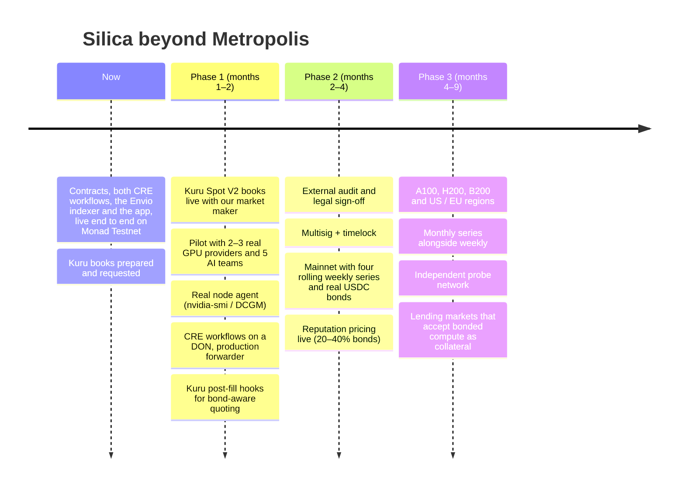

# Roadmap

## Phase 1 · Kuru launch and pilot

- Go live on **Kuru Spot V2** books for the four weekly H100 APAC series, with our market maker and provider asks on day one.
- **Pilot** on testnet with 2–3 real GPU providers and 5 AI startups: replace the simulated node with the real agent and run real redemptions end to end.
- Deploy both workflows to a **Chainlink CRE DON** and switch `DeliveryOracle` to the production forwarder.
- Ask Kuru for **post-fill hook** access, so a provider's ask refills only while its bond still covers more hours.

## Phase 2 · Mainnet

- External **audit**, legal sign-off, and a **multisig plus timelock** on parameters.
- **Mainnet** with four rolling weekly series, real USDC bonds and KYB'd providers.
- **Reputation pricing** live: Envio-scored delivery history moves each provider's bond between 20% and 40%.

## Phase 3 · Scale

- More **hardware** (A100, H200, B200) and **regions** (US, EU), with monthly series alongside weekly ones, all as new Kuru books.
- A **probe network** run by independent operators, so verification doesn't rely on one probe.
- **Composability:** lending markets that accept bonded compute tokens as collateral, and a provider dashboard for automated issuance from idle capacity.

## Longer term

A forward curve for compute that AI teams use to plan and hedge GPU spend, settled by delivery rather than cash.
