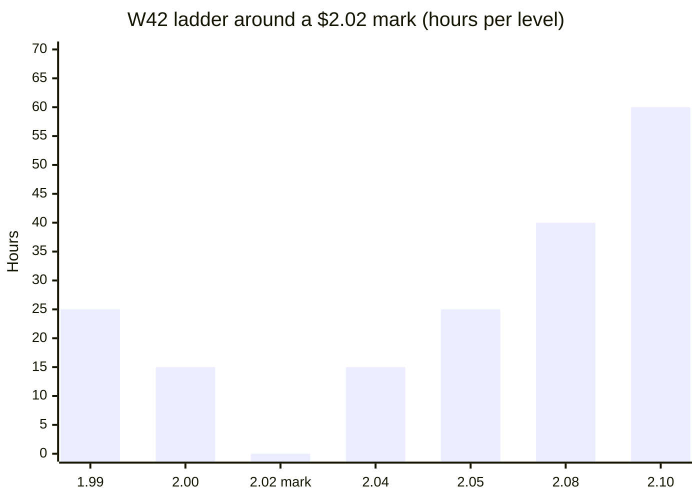

# Market maker

`services/src/mm-bot/index.ts` (+ `kuru.ts`) · testnet-simulated liquidity. It **only quotes**: it never takes liquidity, and SilicaBook rejects self-trades. Fills come from separate, labelled test-buyer wallets.

## The ladder

For every series still before its delivery end:

| Maker | Quotes |
| --- | --- |
| **market-maker** wallet | `LEVELS` bids and asks at `mark ± (SPREAD_TICKS + i) × $0.01` (hosted: 2 levels, sizes 15 and 25 hours) |
| **NeoGPU** (provider asks) | asks at mark + 6 and mark + 8 ticks, 40 and 60 hours |

## Behaviour

- **Re-quotes only when needed:** an order is cancelled and replaced only if it was filled, half-eaten, duplicated, or is no longer at a wanted price (because the mark moved).
- **Never borrows:** a quote is skipped if the wallet lacks the USDC or the hours.
- **Restart-safe:** at startup it rebuilds its open orders **from the chain** (`depth` → `levelOrders` → `orders`), so a restarted container never stacks a second ladder, and it cancels any duplicate at the same price.
- **Retries failed cancels:** a cancel that fails (for example, out of gas) stays tracked and is retried, instead of leaving a live order forgotten.

## Kuru venue

`VENUES=silica,kuru` (the default) also quotes on Kuru. The Kuru venue does nothing until Kuru verifies a book; then it deposits inventory into **AccountCore** and maintains a **post-only GTC ladder** through Kuru's SDK, replaced in one batch whenever the CRE mark moves.

## Configuration

| Variable | Default | Meaning |
| --- | --- | --- |
| `MM_KEY` | | market-maker wallet |
| `PROVIDER_A_KEY` | | enables NeoGPU's ask ladder |
| `LEVELS` | `3` | levels per side (hosted: `2`) |
| `SIZES` | `12,18,26` | hours per level (hosted: `15,25`) |
| `SPREAD_TICKS` | `2` | half-spread in $0.01 ticks |
| `REFRESH_MS` | `15000` | cycle interval |
| `VENUES` | `silica,kuru` | where to quote |
| `KURU_DEPOSIT_HOURS` | `60` | hours to keep deposited per Kuru book |
