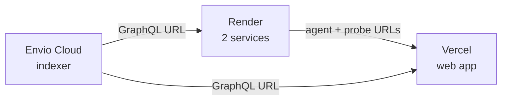

# Hosting

Silica is hosted in three places, deployed in this order because each needs the previous one's URL.



| Piece | Host | URL |
| --- | --- | --- |
| Indexer | Envio Cloud (deploys from the `envio` branch, root `indexer`) | `https://indexer.dev.hyperindex.xyz/581ef33/v1/graphql` |
| Provider agent + market maker | Render, `silica-agent` | `https://silica-agent.onrender.com` |
| Buyer probe + CRE relay | Render, `silica-probe` | `https://silica-probe.onrender.com` |
| Web app | Vercel, root `apps/web` | `https://silica-monard.vercel.app` |

## Render

`render.yaml` is a Blueprint for two **free** web services built from one image, `Dockerfile.services`. `services/run.sh` starts every process named in `SERVICE`:

| Service | `SERVICE` | Processes |
| --- | --- | --- |
| `silica-agent` | `agent,mm` | provider agent (public URL) + market maker |
| `silica-probe` | `probe,relay` | buyer probe (public URL) + CRE relay |

- **Never asleep:** free services sleep after 15 minutes without traffic, and a sleeping agent would miss redemptions. Each container pings its own `RENDER_EXTERNAL_URL/health` every 4 minutes.
- **Fail fast:** if any process exits, the container exits, and Render restarts it.
- **Only rebuilds on service changes:** a `buildFilter` limits redeploys to `services/**`, `packages/shared/**`, the Dockerfile and `render.yaml`.
- **No keys in the image:** `.dockerignore` excludes every `.env`. Keys are entered as `sync: false` variables when the Blueprint is created.

## Vercel

Import the repo with root directory `apps/web` and these public variables (no keys):

```bash
NEXT_PUBLIC_RPC_URL=https://testnet-rpc.monad.xyz
NEXT_PUBLIC_ENVIO_URL=https://indexer.dev.hyperindex.xyz/581ef33/v1/graphql
NEXT_PUBLIC_AGENT_URL=https://silica-agent.onrender.com
NEXT_PUBLIC_PROBE_URL=https://silica-probe.onrender.com
NEXT_PUBLIC_PROVIDER_A=0x3e47F976d224d83F3d6994c5848A329E0ad5FbE0
NEXT_PUBLIC_PROVIDER_B=0xB70b308f0563431eA89406DD6333b2802478D9bd
NEXT_PUBLIC_PROBE_ADDRESS=0x1DF80Ad707F73DAf5E813c8aEda26126d9e13466
NEXT_PUBLIC_HOUR_SECONDS=300
```

## The docs site

The docs live in `apps/web/docs` and ship with the web app: its `build` script runs `vitepress build docs` into `apps/web/public/docs` before `next build`, and `next.config.ts` rewrites the clean URLs to the built `.html` files. Every Vercel deploy of the app therefore publishes the docs at [`/docs`](https://silica-monard.vercel.app/docs) too, with no separate project.

## Operational notes

- **One copy of each service.** The hosted and local services share wallets, so never run both: two market makers would stack quotes and race nonces.
- **Keep wallets funded.** Roughly 1 MON on the relayer, 0.5 MON per provider, and 1 MON on the market maker, topped up from the deployer.
- **The market maker is restart-safe.** It rebuilds its open orders from the chain at startup.
